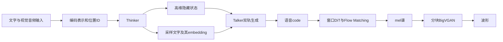

# 多模态感知与流式语音生成：时间对齐和Thinker-Talker

图像、音频和文字进入共享语言层后，需要分别解决输入表示、时间关系与输出生成。Qwen2.5-Omni报告v1将理解/文字生成交给Thinker，将语音code生成交给Talker，再把code恢复为波形。本页解释这一报告的计算依赖与分块设计，不能由结构图推定某个`generate`接口已经按实时交错方式返回声音。

图文token、merger与量化对象见[视觉token基础](vision-language-model-tokens-and-quantization.md)，自回归概率与KV见[Transformer基础](transformer-autoregressive-inference.md)。本页没有运行模型；组件敏感性和部署收益需按[TTS量化评测](../../implementation/tts-quantization-evaluation.md)的独立条件判断。

## 1. 编码表示、语音code与波形是不同对象

Thinker是带视觉/音频编码器的Transformer decoder，接收各模态形成的序列表示，再产生文字和高维隐藏状态。文字经tokenizer/embedding进入语言空间；音频先重采样到16 kHz，转换为128通道mel谱（25 ms窗口、10 ms hop），再编码为约每40 ms一个输入表示。这种连续输入的编码表示不是Talker输出的离散语音code，也不决定输出codec的时间粒度。（§2.1–2.2。）

视觉端采用Qwen2.5-VL编码器，14像素patch经相邻$2\times2$特征合并进入语言层；静态图像在本报告中按两个相同帧处理，视频动态采帧。空间位置数的作用见[动态视觉输入](vision-language-model-tokens-and-quantization.md#1.1%20%E5%8A%A8%E6%80%81%E5%88%86%E8%BE%A8%E7%8E%87%E3%80%81%E7%AA%97%E5%8F%A3%20attention%20%E4%B8%8E%E5%9B%9B%E9%82%BB%E7%89%B9%E5%BE%81%E5%90%88%E5%B9%B6)。音频编码器的结构参照Qwen2-Audio，预训练初始化却来自Whisper-large-v3；结构来源与初始参数不能混为同一事实。（§2.2、§3。）

以下为整理者按图2–4画出的计算依赖，分块与调用时序由后文限定：

同一条路径中，音频输入表示、语言隐藏状态、采样文字ID、输出code、mel与波形各有不同角色。降低某个模块的位宽不自动量化整条链；既有[MASQuant](../../methods/masquant.md)的Omni结果限于Thinker，不能推定Talker、codec或KV使用了相同方案。

## 2. TMRoPE按时间和空间组织音画输入

TMRoPE把RoPE位置分为时间、高度、宽度三个分量。文字的三个ID相同，退化为一维RoPE；音频各时间位置的三个ID也相同，时间尺度为40 ms；图像时间ID保持常数，空间ID随网格位置改变。视频时间ID依据实际时间间隔设置，改变FPS时不能仅对每帧序号加一。不同模态的起始编号按前一模态最大ID加一；这些规则是报告定义，具体取整、频段分配与processor边界尚未核。（§2.2、图3。）

带音轨视频按**实际时间每2秒**分段，在每段中先放视觉表示、后放音频表示，再接下一段。两模态仍有各自的位置数和空间坐标，不要求一帧视觉与一个音频token一一对应。图3的时间刻度0/25/50/75/100/125体现40 ms尺度及2秒分段；不能把它当作所有输入的完整索引算法。（§2.2。）

语言层看到的是展开的序列与位置ID。序列行号、空间网格和音画时间是不同对象；保持物理顺序不等于已经保持时间坐标，重排时也需维护可见关系，参见[位置与mask](vision-language-model-tokens-and-quantization.md#4.%20%E6%A0%A1%E5%87%86%E5%BA%8F%E5%88%97%E3%80%81%E5%9B%9E%E7%AD%94%E6%A0%87%E7%AD%BE%E4%B8%8E%20mask)。时间编码提供对应关系，不保证每个任务都充分利用两种模态。

## 3. Talker同时利用隐藏语义与具体采样文字

Thinker按词表概率采样文字，并将隐藏表示与已采样文字的embedding交给双轨自回归Talker，后者生成语音code和文字token。作者解释：隐藏表示可以提前传递语义、语气等信息，但语义相近的词未必同音；具体采样文字用于消除发音歧义。两种输入分别约束“表达什么/怎样表达”与“实际读哪个词”，不能互相替代。（§2.1、§2.3、图2。）

这是一条表示与输出相连接的生成链，报告不要求先完成整段文字，再交给独立TTS。它也没有规定逐词或逐时间戳的一一对齐；缺少这种对齐要求不等于文字和语音没有依赖。图2的前向/反向箭头支持表示传递与可训练连接，但“共享全部历史context”不能证明两个decoder物理共享同一KV缓存。实际采样、同步、cache与公开调用的返回时序需要匹配代码核对。

## 4. 分块感知和波形生成有不同的窗口

输入侧将音频编码attention从全段改为2秒块；视觉侧用FlashAttention及特征合并，支持多模态chunked prefill。编码器承担局部感知，长序列关系交给后续共享语言模型。这不是整个模型只能看到2秒历史，也不能由编码器块长推定调度器每轮必处理相同长度。（§2.4 Support Prefilling。）

输出侧先由Talker生成codec序列，Flow-Matching DiT将code转换为mel谱，再由修改的BigVGAN恢复波形。报告的DiT attention窗口为当前块、过去两块、未来一块，共四块；BigVGAN也按固定感受野分块。**一块前看意味着需要后续code条件**，所以流式设计仍有等待条件，不能称为零lookahead或严格只看过去。（§2.4、图4。）

输入2秒分段与输出codec块不是同一个参数；v1未给输出块对应的秒数，不能推出首包必等2秒或40 ms。首包还受感知、首个code生成、code到wave及计算/调度影响。该版介绍延迟组成和设计，未报告可用于验证实时性能的首包毫秒、RTF或对应硬件实测；分块、少位宽和实际端到端加速分别验证。

## 5. 训练阶段和监督目标分别限定参数更新

预训练先固定Qwen2.5语言骨干，两个模态各先训练adapter、再训练编码器；第二阶段解冻全部参数，第三阶段加入长音频/视频并把此前8192长度扩为32768。训练长度不独立保证全部推理窗口，端到端结构也不表示每个阶段更新所有模块。Thinker后训练用ChatML多模态指令数据。（§3、§4.1–4.2。）

Talker依次做语音续写next-token训练、偏好优化和speaker fine-tuning。首阶段包含文字监督与语音续写；偏好阶段用WER和标点停顿误差排序构造好/坏语音序列。将被优化策略记为$\pi_\theta$、reference记为$\pi_{\rm ref}$，原文DPO目标可改写为

$$
\Delta_\theta(x,y)=\log\frac{\pi_\theta(y\mid x)}{\pi_{\rm ref}(y\mid x)},\qquad
\mathcal L_{\rm DPO}=-\mathbb E_{(x,y_w,y_l)\sim\mathcal D}
\log\sigma\!\left(\beta[\Delta_\theta(x,y_w)-\Delta_\theta(x,y_l)]\right).
$$

$x$是含请求/回答文字的输入条件，$y_w,y_l$是偏好与非偏好语音序列，$\mathcal D$是配对数据，$\sigma$为sigmoid，β调节相对概率差的尺度。目标提高好序列相对reference的概率优势，而非把WER数值直接当作每个token的监督。原文将此阶段称RL，给出的机制是DPO；不能搬用[GRPO](reasoning-post-training-and-distillation.md)的采样组、reward标准化或R1超参。具体reference建立、参数子集、token mask/归约和优化超参未核。（§4.3、DPO式；仅作符号改写。）

最后speaker fine-tuning让Talker适配特定声音。它改变语音生成条件与风格，不提供整条链的量化保真证明；不同speaker的WER和自然度也需分别报告。

## 6. 语音质量、模态能力与实时性能分别评测

报告主要评测Omni-7B。因缺相应综合评测，X→Speech主要按“给定文字生成语音”的TTS方式检查，不能代表完整音画交互。SEED表9用WER测内容一致性、SIM测说话人相似度；ICL→偏好优化后，test-zh/en/hard WER（%）为1.70/2.72/7.97→1.42/2.33/6.54，SIM为0.752/0.632/0.747→0.754/0.641/0.752。两指标回答不同问题，这些是作者训练阶段结果，不是量化对照。（§5.2、表9。）

表10的speaker B中文NMOS4.51与表列Human4.51相同，来自自建集的主观评分；表中未给完整样本、听者与区间，不能据同一个四舍五入均值证明统计等价或所有语言/交互达到人类水平。该表标RL的中文WER为1.30%，表9同标记为1.42%；配置差异未交代完整，保留两表范围而不拼成同一基线。（表9–10。）

“多模态模型更强”也需要任务条件：Omni-7B在表1MMLU-Pro为47.0，Qwen2.5-7B为56.3；Video-MME无字幕64.3低于VL-7B的65.1，有字幕72.4高于71.6；OmniBench平均56.13%不能掩盖Music52.83%低于video-SALMONN的56.60%。语音指令自建对照只转换约90%适合语音的文字问题，且基线模型/输入方式不同，不能当成逐样本音频与文字完全等价。（表1/4/7/8。）

质量对照需要固定模态预处理、提示、声音、抽样与Flow Matching预算；部署另记录首包、持续输出速率、实际音频时长和组件执行范围。通用[TTS质量与真实执行](../../implementation/tts-quantization-evaluation.md)提供判据与失败模式，不能从本页任何单项分数推出量化后同时保质、提速与节能。

## 来源身份与未核范围

- Qwen2.5-Omni Technical Report（`https://arxiv.org/abs/2503.20215v1`），`arXiv:2503.20215v1`；20页PDF。编入主文的架构/预训练/后训练、必要输入/输出评测与图2–4、表1/4/7–10；关键原件回查。源包未编入的Qwen2 appendix残稿排除；DPO仅符号改写。
- 未逐表审计全部感知任务/引用材料，未核匹配processor、Thinker/Talker/codec调用、时间取整、同步/cache、窗口实现、dtype/低比特或模型/训练/语音/设备运行。论文的流式设计不替代公开接口与真实性能验证。
