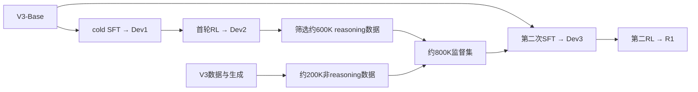

# 推理模型后训练：GRPO、模式控制与蒸馏

推理模型后训练改变的是模型如何生成和选择回复。DeepSeek-R1报告v2用可验证任务的奖励更新自回归策略，再以筛选输出做SFT，将监督迁移到其他模型。Qwen3报告v1则将两种生成模式融入同一模型，并对轻量学生接续输出监督和on-policy软分布匹配。RL、蒸馏和低位量化分别改变训练目标、监督/学生架构和数值表示，不能由“Distill”名称推定权重或KV位宽。

本页核读R1-Zero/R1方法、必要数据与阶段配置、GRPO/PPO补充说明、蒸馏及对应评测证据，并核Qwen3的模式融合/预算、两阶段蒸馏和必要对照，没有运行trainer或模型。生成概率的基础见[自回归推理](transformer-autoregressive-inference.md)，抽样/投票协议见[质量评测](../../implementation/model-quality-evaluation.md#3.5%20%E5%A4%9A%E6%AC%A1%E6%8A%BD%E6%A0%B7%E3%80%81%E5%8D%95%E6%AC%A1%E6%88%90%E5%8A%9F%E4%B8%8E%E5%A4%9A%E6%95%B0%E6%8A%95%E7%A5%A8)；R1报告86页中的全部安全、答题样例与人评细节不在本项审核范围。

## 1. GRPO用组内奖励更新策略概率

策略$\pi_\theta(o\mid q)$表示模型在问题q下生成回复o的概率，θ是被优化的模型参数。对同一q，旧策略$\pi_{\rm old}$采样G个回复$o_i$，验证器给$r_i$；组内标准化得到

$$A_i=\frac{r_i-\bar r}{s_r},\qquad
\rho_i=\frac{\pi_\theta(o_i\mid q)}{\pi_{\rm old}(o_i\mid q)}.$$

$\bar r,s_r$是该组reward均值和std，$A_i$表达同题组内的相对效果；不学习单独的value/critic网络。原式没有给全部reward相同、$s_r=0$时的稳定分支。将论文纸面目标中的单样本KL项记为$\widehat k_i$，可整理为最大化

$$
\mathcal J(\theta)=
\mathbb E_{q\sim P(Q),\;o_{1:G}\sim\pi_{\rm old}(\cdot\mid q)}
\frac1G\sum_i
\left[
\min\{\rho_iA_i,\operatorname{clip}(\rho_i,1-\epsilon,1+\epsilon)A_i\}
-\beta\widehat k_i
\right].
$$

$P(Q)$是训练问题分布。在概率比率这一项中，正$A_i$鼓励提高已采样回复的概率，负$A_i$鼓励降低它；clip让朝该方向过大的比率变化不再增加surrogate收益，不能保证整个目标的更新方向或把比率硬限制在区间内。

Reference策略$\pi_{\rm ref}$提供KL基准。Old负责采样与概率比率，reference负责约束；它们在一次更新中不随actor梯度更新，但reference按训练日程替换。纸面使用output-level概率比，未展开实际token logprob、mask、长度归约或importance修正，因此这不是可直接运行的loss实现。（正文Group Relative Policy Optimization；附录GRPO/PPO比较。）

论文将$x_i-\log x_i-1$写作KL，其中$x_i=\pi_{\rm ref}(o_i\mid q)/\pi_\theta(o_i\mid q)$。这是**单样本估计项**$\widehat k_i$，不是完整分布KL本身。整理者推导：固定q、两分布相同支持且概率为正、期望有限时，若$o\sim\pi_\theta$，则$\mathbb E[x]=1$，故$\mathbb E[\widehat k]=D_{\rm KL}(\pi_\theta\|\pi_{\rm ref})$；不能直接把旧策略样本上的未加权期望也称无偏。教学反例：$\pi_\theta=(0.5,0.3,0.2)$、$\pi_{\rm ref}=(0.5,0.2,0.3)$，取首项样本时$\widehat k=0$，完整KL却约0.04055 nats。原文称其无偏，匹配trainer如何衔接采样分布仍未核。

R1-Zero和R1首RL均报告G=16、学习率$3\times10^{-6}$、β=0.001、rollout温度1；每更新32题/512回复，每rollout8192回复拆16个mini-batches，只训一个inner epoch，reference每400步替换。R1首RL另明确ε=10；按字面clip区间为[-9,11]，正概率比下下界不限制，不能套窄区间直觉，也不是把所有更新后的比率硬限制在该区间。Zero段未给ε数值，不能转填为10。（正文Zero配置、First RL Stage。）

GRPO省去critic的训练/存储，不等于总成本减半。报告基础设施仍包含rollout、reference/model奖励推理、规则验证及actor训练；规则验证可与其他阶段异步重叠，模型阶段结束后offload。通用框架支持optional critic不表示R1的GRPO使用了critic；匹配vLLM rollout、同步、packing与实际峰值未核。（附录RL Infrastructure、GRPO/PPO比较。）

## 2. 规则奖励依赖可验证目标与检查范围

R1-Zero方法节将accuracy和format **等权相加**，比引言“solely correctness”的概括更具体。Accuracy比较最终答案或执行给定tests；format检查指定输出标签，不证明中间步骤正确。数学数据排除难自动判断的proofs，STEM按正确选项计分，logic任务按可自动评价形式构造。规则验证省去神经评分模型，仍需reference答案、tests、parser和数据设计。（Reward Design、附录RL Data。）

代码cold-start数据的tests由V2.5产生候选，再用正确提交筛无效tests、用错误提交选能抓错的子集。通过这组tests是覆盖范围内的证据，不是任意程序正确性的证明；rejection sampling还筛正确性、重复/混语言与可读格式，并经V3改写和人工核验。不能把“没有先做SFT的Zero路径”写成无预训练、无人类数据或任意无标签任务都能验证。（附录Cold Start、800K Supervised Data。）

R1首RL增加目标语言词占比奖励，作者报告可读性与任务成绩有取舍。第二RL对reasoning使用规则奖励，对general使用所属helpful/safety数据的模型奖励并加格式/语言项；helpful评价final summary，safety评价整个回复，不是每题都同时加两个神经奖励。第二RL共1700步，温度降为0.7，general/preference只在最后400步加入；其他参数仅说大体沿用，未逐项重述。（Model-based Rewards、Training Details。）

## 3. 训练参数与监督数据怎样接续

Zero从V3-Base直接做规则RL；R1则先用Zero输出筛选、V3/人工整理的cold-start数据对V3-Base做SFT。下面是按pipeline原图与SFT配置整理的参数/数据关系：

**第二次SFT重新从V3-Base开始**；Dev2贡献筛选数据，不能画成Dev2参数直接继续SFT成Dev3。表中800K是概数，数据统计表总计804,745；蒸馏段泛称R1输出，具体构造仍需按Dev2/V3及人工验证的来源分开。多数数据为单轮，不由这条训练链保证多轮表现。（正文R1 pipeline；附录SFT Hyper-Parameters/800K数据。）

约600K reasoning数据的筛选范围比首RL的规则奖励更广：部分新增数据把gold答案与模型预测交给V3生成式奖励模型判定。该判定用于筛选监督轨迹，不能反推首RL使用了神经reasoning奖励；筛选正确终点也不证明全部中间步骤正确。（附录800K Supervised Data。）

这些阶段同时改变训练数据、奖励、可读性和推理行为，不是单一变量的等预算消融。阶段表中Zero→Dev1的IFEval46.6→71.7而AIME77.9→59.0；最终R1的GPQA71.5、CNMO78.8也低于Zero75.8、88.1。整体取舍不能写成每阶段每项单调提升。（Performance Comparison with DeepSeek-V3及对应阶段表。）

### 3.1 Qwen3在同一参数链上融合两种模式

Qwen3 v1的旗舰32B和235B-A22B依次从Base经历long-CoT cold start、Reasoning RL、Thinking Mode Fusion SFT和General RL。Cold-start用QwQ-32B产生候选，筛终点正确、重复/猜测、思考与summary不一致和疑似validation近似；Reasoning RL使用3995个不与cold-start重合的query-verifier pairs及GRPO。报告提到大batch、多rollouts、off-policy利用率与entropy控制，没有给R1的G/ε/β/reference日程，不能移植这些数值。（§4.1–4.2、图1。）

Mode Fusion**继续更新Reasoning RL模型**，不是R1第二SFT重新从Base开始的参数关系。Thinking数据由Stage2模型在Stage1问题上做rejection sampling，non-thinking数据覆盖通用任务；同一权重学习两种模板。报告以`/think`、`/no_think`控制，默认thinking，non-thinking保留内容为空的think block（示意为`<think></think>`），多轮按最后flag训练响应。表9脚注称发布模板以`enable_thinking=False`关闭思考段输出；这是报告语义，匹配发布tokenizer尚未核。模式控制改变生成行为，不等于换checkpoint、关闭某个参数子集或停止所有内部计算。（§4.3、表9。）

General RL覆盖20多任务，使用规则、带reference答案的Qwen2.5-72B-Instruct评分，以及不带reference的偏好reward model；工具rollout包含真实环境反馈，属于作者训练范围，本项目未执行。32B表22在thinking模式下Stage2→Stage4的IFEval73.0→85.0，但AIME83.8→81.4、LCB68.4→65.7。ThinkFollow从Stage3的88.7到Stage4的98.9，仍非100%，且为自建集。通用性、模式跟随与专门任务表现分别判断。（§4.4、§4.7、表22。）

## 4. 蒸馏的监督数据、软目标与学生规模

所发布R1-Distill模型用约800K监督数据只做SFT，没有随后RL。它学习筛选回复的token文本，不以完整teacher logits软分布为目标；[LLM-QAT](../../methods/llm-qat.md#4.%20%E8%92%B8%E9%A6%8F%E4%BC%98%E5%8C%96%E7%9A%84%E6%98%AF%E6%A6%82%E7%8E%87%E5%88%86%E5%B8%83)则在同一前缀匹配教师概率，并让学生量化前向。R1输出SFT没有给出低比特码值、scale/zero或KV布局，减少学生架构规模与降低数值位宽分别判断。（Distillation、Distillation Hyper-Parameters。）

| 学生系列 | 本版登记起点 |
| --- | --- |
| Qwen 1.5B/7B | Qwen2.5-Math对应模型 |
| Qwen 14B/32B | Qwen2.5对应模型 |
| Llama 8B | Llama-3.1-8B |
| Llama 70B | Llama-3.3-70B-**Instruct** |

不能统一称为未经指令调优的base。蒸馏2–3 epochs、batch64、context32,768、cosine LR降到初值1/10；各学生初始LR由配置表另定。Teacher生成/筛选、学生训练和部署成本均需计入，不能只数学生参数。（Distillation配置表。）

32B蒸馏模型与从Qwen2.5-32B-Base做超过10K步RL的Zero对照，AIME pass@1为72.6对47.0，MATH94.3对91.6；这支持该配方下的迁移效果，没有等数据、FLOPs、GPU时或完整teacher成本对齐，不能推出蒸馏普遍比RL更好且更便宜。1.5B的数学结果也没有支持所有任务全面超过表列闭源模型。（Distillation vs. Reinforcement Learning及两张结果表。）

### 4.1 Qwen3从教师输出转到学生前缀上的软监督

轻量分支为0.6/1.7/4/8/14B dense及30B-A3B MoE，不为每款单独跑完整四阶段。先off-policy学习教师在thinking/non-thinking两模式产生的回复，再由学生自行生成两模式序列，以32B或235B-A22B教师在这些前缀上的logits做KL匹配。前一步迁移输出数据，后一步让软监督落在学生实际访问的前缀；它们不能统一写成R1式800K纯输出SFT。（§4.5、图1。）

同前缀词表软目标的基础可复用[LLM-QAT](../../methods/llm-qat.md#4.%20%E8%92%B8%E9%A6%8F%E4%BC%98%E5%8C%96%E7%9A%84%E6%98%AF%E6%A6%82%E7%8E%87%E5%88%86%E5%B8%83)，但Qwen3没有因此使用量化前向。报告未展开KL方向、温度、token mask/长度归约或词表对齐，不能补造已核loss实现。

表21仅比较**同一off-policy 8B checkpoint的接续训练**，queries限math/code：on-policy蒸馏用1800 GPUh、直接RL用17920 GPUh，AIME'24 pass@1为74.4/67.6，括号pass@64为93.3/90.0。约1/10对应这个接续阶段，不是全系列总训练或部署成本；初始off-policy、完整teacher成本和硬件效率未拆齐。方法增量与实际数值位宽仍分别验证。（§4.7、表21。）

## 5. 输出预算与抽样协议限定质量结论

Zero在8.2K步把训练每响应上限32,768提升到65,536，正文明确将成绩与长度跳升联系该改变。另段将长度增长概括为“solely intrinsic adaptation”不能排除这项外部干预；平均长度图来自训练集，不是测试平均成本。公开输出中的反思词频和风格是行为观测，不能单独证明内部认知机制或突然涌现。（Zero配置、训练两图、Self-evolution段。）

最终R1的AIME pass@1、pass@64、cons@64分别回答单次成功概率、多次尝试覆盖和多数票选择；Zero图中的cons@16又有不同预算，不能因86.7%数值相同就换成最终R1的cons@64。具体生成长度、温度、次数与保留条件见[抽样评测](../../implementation/model-quality-evaluation.md#3.5%20%E5%A4%9A%E6%AC%A1%E6%8A%BD%E6%A0%B7%E3%80%81%E5%8D%95%E6%AC%A1%E6%88%90%E5%8A%9F%E4%B8%8E%E5%A4%9A%E6%95%B0%E6%8A%95%E7%A5%A8)。训练reward、短任务、通用能力及量化保真对照还需分别定义。

### 5.1 思考预算控制输出阶段，不保证每类任务受益

Qwen3的thinking budget限制**思考段输出tokens**：到阈值后停止该段、追加要求直接作答的文本和结束标记，再生成final response。它不同于耗尽整段max output length，后者可能连答案都未产生；部署需给答案留预算，并记录插入文本/截断与实际总tokens。作者把中断后作答归于模式融合、称未专门显式训练这项能力；此归属不能保证任意阈值都正确。（§4.3。）

图2只测235B-A22B在AIME'24/25、LCB与GPQA四任务的1/2/4/8/16/32K思考预算，展示所测pass@1收益，不证明每题、每任务或无限加长都单调提升。超过32K继续改善是future-work预期；本文AIME另有38,912的**总输出**上限，两种预算不能混用。RULER中更多思考的退化与具体解码条件见[Qwen3质量协议](../../implementation/model-quality-evaluation.md#3.6%20Qwen3%E7%9A%84%E6%A8%A1%E5%BC%8F%E3%80%81%E6%80%BB%E8%BE%93%E5%87%BA%E4%B8%8E%E4%BB%BB%E5%8A%A1%E9%A2%84%E7%AE%97)。（§4.6–4.7、图2、附录A.1.1。）

## 来源身份与未核范围

- Qwen3 Technical Report（`https://arxiv.org/abs/2505.09388v1`），`arXiv:2505.09388v1`；§3–4的必要训练/模式/蒸馏与评测、图1–2/表9/21–23，35页PDF关键原件回查；未逐表审全部模型/语言结果、匹配trainer/KL与发布模板或运行，未编入experiments残稿排除。

- DeepSeek-R1: Incentivizing Reasoning Capability in LLMs via Reinforcement Learning（`https://arxiv.org/abs/2501.12948v2`），`arXiv:2501.12948v2`；PDF86页，首页4Jan2026。正文方法/奖励/阶段、必要Zero结果，附录GRPO/PPO、infra/数据/超参、蒸馏与必要评测；六张原图和关键PDF页回查。KL恒等关系与反例为整理者推导。
- 未核匹配trainer/rollout、actor更新子集、oldlogprob/同步、zero-std、token mask/归约、reward parser/test覆盖、数值dtype/打包和真实训练/评测；未逐项审计全部安全、答题样例及人评细节。已有实现与公开输出不能替代这些验证。
