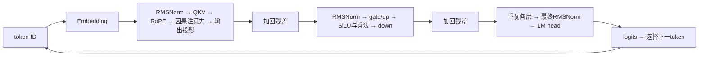

# Transformer 与自回归推理：从 token 到 KV cache

自回归语言模型用已有 token 预测下一个 token。量化所改变的权重、激活和 KV cache 位于同一条计算链的不同位置。本页以 Llama 风格的稠密、pre-norm、因果 decoder 为例，先给出逻辑计算，再与 vLLM、SGLang 的实现衔接；不把这一结构当作所有 Transformer 的定义。

## 1. 一次前向究竟输入和输出什么

设词表大小为 $V$，隐藏维为 $D$，当前参与计算的 token 数为 $T$。token ID 经 embedding 得到 $X\in\mathbb R^{T\times D}$，逐层更新后，经最终归一化与 LM head 得到 logits $Z\in\mathbb R^{T\times V}$。第 $t$ 行经 softmax 表示 $p(x_{t+1}\mid x_{\le t})$；贪心选择或采样决定下一个 token。词表概率不等于任意问答任务上的“答案正确概率”。

图中省略了从每个子层输入到残差相加点的旁路。记 $N$ 为 RMSNorm，则一层的逻辑公式是

$$H=X+\operatorname{Attention}(N(X)),\qquad
X'=H+\bigl[\operatorname{SiLU}(N(H)W_g)\odot N(H)W_u\bigr]W_d.$$

这里 $W_g,W_u\in\mathbb R^{D\times F}$、$W_d\in\mathbb R^{F\times D}$，$F$ 是 MLP 中间宽度。正文使用右乘矩阵，PyTorch 的 `Linear.weight` 通常保存其转置，见 [线性层与输入通道](../operators/linear-layer-input-channel.md)。非线性和残差限制了变换可以搬动的位置，这正是 [等价缩放](../../theory/diagonal-scaling-equivalent-transform.md)需要逐接口证明的原因。

vLLM `LlamaDecoderLayer.forward` 将残差保存在另一条张量流中，交给 RMSNorm 融合相加；源码返回两条流，不表示数学图没有残差。舍入顺序与融合语义见 [RMSNorm 实现](../../implementation/rmsnorm-cuda-triton-kernels.md)。

## 2. Q、K、V 的形状与共享关系

设 query head 数为 $H_q$，KV head 数为 $H_{kv}$，每头维度为 $d$。投影后：

| 张量 | 逻辑形状 | 作用 |
| --- | --- | --- |
| Q | $[T,H_q,d]$ | 当前 token 对历史信息的查询 |
| K | $[T,H_{kv},d]$ | 当前 token 将来被查询时的匹配特征 |
| V | $[T,H_{kv},d]$ | 匹配后参与加权求和的内容 |

通常 $D=H_qd$，但应以模型配置为准。MHA 取 $H_{kv}=H_q$；MQA 取 $H_{kv}=1$；GQA 介于两者之间。整除且连续分组时，query head $h$ 使用 KV head $g(h)=\lfloor h/(H_q/H_{kv})\rfloor$。共享的是 K/V，query heads 仍有各自的 Q 与注意力分布。

标准 RoPE 对位置相关的 Q、K 二维坐标对施加旋转；V 不做该旋转。记旋转后为 $\widetilde Q,\widetilde K$，位置 $t$ 的一头输出为

$$a_{t,j,h}=\operatorname{softmax}_{j\le t}
\left(\frac{\widetilde Q_{t,h}\widetilde K_{j,g(h)}^\top}{\sqrt d}\right),\qquad
O_{t,h}=\sum_{j\le t}a_{t,j,h}V_{j,g(h)}.$$

因果 mask 在 softmax **之前**排除未来位置，否则未来值已经影响归一化分母。拼接各 query head 后，$[T,H_qd]$ 经过输出投影回到 $[T,D]$。`LlamaAttention.forward` 的 QKV split → rotary → attention → o_proj 对应这条链；实现通常融合计算，不要求物化完整注意力矩阵。[FlashAttention](../../theory/flash-attention-tiling-and-recomputation.md)解释如何精确分块并在训练反向重算概率，分页与在线执行见 [vLLM Attention](../../implementation/vllm-attention-operator-design.md)；一次调用的临时矩阵与跨轮KV cache分别计账。

### 2.1 Llama 3.1的配置与逻辑KV容量

《The Llama 3 Herd of Models》v3将Llama 3.1简称为Llama 3，表1明确全部结果对应3.1，不能套到2024年4月发布的同名8B/70B。其稠密模型沿上述GQA/SwiGLU计算链，配置为：

| 模型 | 层数$N_l$ | 隐藏维$D$ | FFN维$F$ | Q/KV heads | $d=D/H_q$ |
| --- | ---: | ---: | ---: | ---: | ---: |
| 8B | 32 | 4096 | 14336 | 32 / 8 | 128 |
| 70B | 80 | 8192 | 28672 | 64 / 8 | 128 |
| 405B | 126 | 16384 | 53248 | 128 / 8 | 128 |

原文表3记词表128,000、RoPE θ=500,000；GQA的KV heads均为8，不随Q heads增加。按§4容量式，以BF16两字节计算，全模型逻辑KV每token分别128/320/504 KiB，长度131,072时为16/40/63 GiB。这是整理者计算，未含分页浪费、量化元数据、TP复制或前缀共享，不是每rank实际显存。论文的[选择性FFN FP8推理](../numeric-formats/fp8-and-mx-data-formats.md#3.1%20Llama%203.1%E7%9A%84%E9%80%89%E6%8B%A9%E6%80%A7FP8%E6%8E%A8%E7%90%86)也没有据此提出KV量化。（v3 §3.2，表1/3。）

## 3. Prefill、decode 与 teacher forcing

输入有 $P$ 个 token 时，prefill 同时计算这些位置。因果 mask 使它们只能看各自前缀；最后位置的 logits 用来选择第一个生成 token。随后把这个新 token 输入模型，利用已有 KV 计算下一轮 logits。**选择一个 token 与把它送入模型形成 KV 是相邻的两个步骤**，不能把“已经采样”直接当作“已经缓存”。

Teacher forcing 给每个位置真实的前文 token，因此可以同时计算整段序列的 next-token 损失。自由生成则把模型自己的输出接回输入，一个早期差异会改变后续上下文。所以 [PPL 评测](../../implementation/model-quality-evaluation.md)与生成问答准确率衡量的行为不同。

调度可把 prefill 分段，也可把多个请求的 decode 合并。线性层的 GEMM 行数 $M$ 是本轮实际送入的 token 数：8 个请求各推进一个 token 时 $M=8$，并非 8 次必须独立执行的 GEMV。prefill/decode 是请求进度语义，不能单独决定算子的形状或瓶颈；详见 [vLLM token 调度](../../implementation/vllm-inference-execution.md)与 [roofline](../hardware/arithmetic-intensity-and-roofline.md)。

### 3.1 MTP的额外训练目标与推理用途

DeepSeek-V3 v2的Multi-Token Prediction在主模型之外串联D个附加模块。深度k接收上一深度$h_i^{k-1}$和训练中已知token $t_{i+k}$的embedding，两者分别RMSNorm后拼接、投影到隐藏维，再经附加Transformer block及output head，预测$t_{i+k+1}$。Embedding和output head均与主模型共享。输入token与预测目标错开一位，保留完整因果链；不是D个独立head并行猜相同前缀之后的所有token。（§2.2、图3。）

本节沿原文列向量记号，$d$为隐藏维、$D$为额外预测深度；$M_k\in\mathbb R^{d\times2d}$，$h_i^0$来自主模型。逐位置先得到投影，再将整段投影序列交给因果Transformer：

$$
h_i^{\prime k}=M_k[\operatorname{RMSNorm}(h_i^{k-1});\operatorname{RMSNorm}(\operatorname{Emb}(t_{i+k}))],\qquad
h_{1:T-k}^k=\operatorname{TRM}_k(h_{1:T-k}^{\prime k}).
$$

第二式保留位置之间的因果attention依赖，不能改成每个位置独立的向量函数。各深度CE附加到主next-token训练目标：

$$
\mathcal L_{\rm MTP}^k=-\frac1T\sum_{j=k+2}^{T+1}\log P_j^k[t_j],\qquad
\mathcal L_{\rm MTP}=\frac\lambda D\sum_{k=1}^D\mathcal L_{\rm MTP}^k.
$$

$T$是原文输入序列长度，$P_j^k[t_j]$为目标token概率；保留原式1/T，没有将不同深度的有效项数改成相同分母之外的新平均规则。实际V3取D=1，即多一个future target，λ前10T tokens为0.3、后4.8T为0.1。MTP加密训练监督，但普通推理可丢弃模块，主模型仍逐token执行；部署也可复用模块做推测，验证/接受协议需另核。

MTP消融保持其余架构/数据，比较15.7B/1.33T和228.7B/540B两组，推理均丢弃附加模块以保持成本；多数任务改善，但大模型MMLU67.5→66.6、小模型NQ22.7→22.3，不能写所有任务提升。作者另报告第二token接受率85–90%及1.8×TPS，缺完整workload/后端/硬件/验证协议，不是当前服务框架实测。配套参数共享与精度边界见[FP8训练](../../implementation/deepseek-v3-fp8-training.md)。（§4.2、MTP消融表及§5.4.3。）

## 4. 为什么缓存 K/V，而不是每轮重算历史

固定模型、位置与前缀，在因果推理中，新增未来 token 不改变历史 token 已经算出的 K/V。因而每层只追加新 token 的 K/V，后续查询复用它们。历史 Q 对以后的位置没有直接用途，logits 是词表空间的预测，也不能替代每层的 K/V。

单请求长度为 $L$、层数为 $N_l$、每个缓存元素为 $b$ 字节时，不计量化元数据和分配浪费，逻辑 KV 大小为

$$B_{KV}=2N_lLH_{kv}db.$$

教学例：$N_l=32,L=2048,H_{kv}=8,d=128,b=2$，共 256 MiB；同样条件下 MHA 若 $H_{kv}=32$，则为 1 GiB。这是全模型逻辑缓存，不是某个 TP rank 的实际分配量。分页、复制、共享前缀及量化元数据都可能改变实占。

缓存复用依赖模型权重、位置规则与前缀身份。改变这些条件后，旧 KV 不自动仍然有效。KV 数值在线产生，但量化策略与某些变换可离线校准；历史可通过重新前向恢复，只是有计算成本。机制见 [KV cache 量化](../../theory/kv-cache-quantization-objects-and-granularity.md)，管理见 [SGLang 缓存与调度](../../implementation/sglang-inference-execution.md)。

## 5. 从逻辑图进入代码与量化

vLLM 与 SGLang 所选 `llama.py` 都把 gate/up 合并投影，把 Q/K/V 合并投影，再使用行并行的 down/o 投影。这减少或组织调用，同时给分片布局施加约束，见 [张量并行与量化分片](../../implementation/tensor-parallel-quantization.md)。

权重量化改变这些投影的参数表示；激活量化改变进入乘法的中间张量；KV 量化改变跨轮保存的 K/V。三者作用的时间、误差传播和收益不同，不能仅用一个“4 bit 模型”标签代替完整配置。图中的 gate/up、归一化和投影分别连接 [门控激活](../../implementation/gated-activation-cuda-triton-kernels.md)、[RMSNorm](../../implementation/rmsnorm-cuda-triton-kernels.md)与 [量化 GEMM](../../implementation/tensor-core-quantized-gemm.md)。

本页公式和容量例子是依据所选实现整理的逻辑解释与教学计算；没有执行模型。滑窗、交叉注意力、MoE 和推测执行不由这个基本例子覆盖。

沿这条主干理解结构变化时，[MoE 与专家路由](mixture-of-experts-and-routing.md)解释 FFN 如何按 token 选择专家，以及总参数与激活参数为何不同；[MLA](multi-head-latent-attention.md)解释 attention 如何保存联合潜变量与位置 key。上面的 $2N_lLH_{kv}db$ 是显式 K/V 的容量模型，MLA 需要按自己的缓存对象记账。

## 来源身份

- DeepSeek-V3 Technical Report（`https://arxiv.org/abs/2412.19437v2`），`arXiv:2412.19437v2`；§2.2/图3、§4.2、MTP消融与§5.4.3报告；原式分母保留，匹配训练/推测实现与运行未核。

- The Llama 3 Herd of Models（`https://arxiv.org/abs/2407.21783v3`），`arXiv:2407.21783v3`；表1的3.1身份、§3.2/表3配置；KV值为整理者按本页公式计算，未执行模型。

- FlashAttention: Fast and Memory-Efficient Exact Attention with IO-Awareness（`https://arxiv.org/abs/2205.14135v2`），arXiv:2205.14135v2；本页§2的精确分块与反向重计算连接，原文§3.1、附录B；不替代所选Llama实现证据。
- vLLM（`https://github.com/vllm-project/vllm/tree/568afb3a13806beb53bb2e6bd518269357b237c0`），固定 commit `568afb3a13806beb53bb2e6bd518269357b237c0`；`model_executor/models/llama.py` 中 `LlamaMLP`、`LlamaAttention`、`LlamaDecoderLayer`、`LlamaModel`、`LlamaForCausalLM`。
- SGLang（`https://github.com/sgl-project/sglang/tree/2f730e299f3b574e3bee2c6ef9669fa2a5b26dbc`），固定 commit `2f730e299f3b574e3bee2c6ef9669fa2a5b26dbc`；`python/sglang/srt/models/llama.py` 的对应模块与投影组织。
