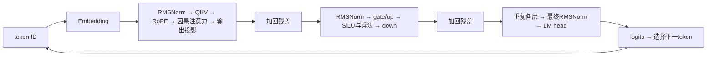

# Transformer 与自回归推理：从 token 到 KV cache

自回归语言模型用已有 token 预测下一个 token。量化所改变的权重、激活和 KV cache 位于同一条计算链的不同位置。本页以 Llama 风格的稠密、pre-norm、因果 decoder 为例，先给出逻辑计算，再与 vLLM、SGLang 的实现衔接；不把这一结构当作所有 Transformer 的定义。

## 1. 一次前向究竟输入和输出什么

设词表大小为 $V$，隐藏维为 $D$，当前参与计算的 token 数为 $T$。token ID 经 embedding 得到 $X\in\mathbb R^{T\times D}$，逐层更新后，经最终归一化与 LM head 得到 logits $Z\in\mathbb R^{T\times V}$。第 $t$ 行经 softmax 表示 $p(x_{t+1}\mid x_{\le t})$；贪心选择或采样决定下一个 token。词表概率不等于任意问答任务上的“答案正确概率”。

图中省略了从每个子层输入到残差相加点的旁路。记 $N$ 为 RMSNorm，则一层的逻辑公式是

$$H=X+\operatorname{Attention}(N(X)),\qquad
X'=H+\bigl[\operatorname{SiLU}(N(H)W_g)\odot N(H)W_u\bigr]W_d.$$

这里 $W_g,W_u\in\mathbb R^{D\times F}$、$W_d\in\mathbb R^{F\times D}$，$F$ 是 MLP 中间宽度。正文使用右乘矩阵，PyTorch 的 `Linear.weight` 通常保存其转置，见 [线性层与输入通道](../operators/linear-layer-input-channel.md)。非线性和残差限制了变换可以搬动的位置，这正是 [等价缩放](../../theory/diagonal-scaling-equivalent-transform.md)需要逐接口证明的原因。

vLLM `LlamaDecoderLayer.forward` 将残差保存在另一条张量流中，交给 RMSNorm 融合相加；源码返回两条流，不表示数学图没有残差。舍入顺序与融合语义见 [RMSNorm 实现](../../implementation/rmsnorm-cuda-triton-kernels.md)。

### 1.1 原始encoder–decoder的三类attention

《Attention Is All You Need》v7研究序列到序列任务：encoder将输入序列编码为上下文表示，decoder用已知目标前缀逐个生成输出。原base的encoder和decoder各6层，隐藏宽度$D=512$；encoder每层依次做self-attention与FFN，decoder每层依次做因果self-attention、cross-attention与FFN。（§3.1，图1。）

| 子层 | Q的来源 | K/V的来源 | 可见位置 |
| --- | --- | --- | --- |
| Encoder self-attention | 进入该子层的encoder状态 | 同一状态 | 全部输入位置 |
| Decoder self-attention | 进入该子层的decoder状态 | 同一状态 | 当前及之前的decoder输入位置 |
| Encoder–decoder cross-attention | 进入该子层的decoder状态 | encoder最终输出 | 全部source位置 |

这里的Q/K/V仍由各自可学习投影得到，不把原始token ID直接当向量。设decoder状态有$M$行、encoder上下文有$N$行，单头Q为$[M,d_k]$、K为$[N,d_k]$、V为$[N,d_v]$；cross-attention输出为$[M,d_v]$，输出位置数跟随query而不是source长度。两段不必等长，完整尺寸关系见[注意力的query与上下文](../../theory/attention-quantization-error-propagation.md)。这些形状是按原式1展开的整理者说明。（§3.2.1–3.2.3。）

decoder的目标embedding右移一位，再由因果mask排除未来输入位置，两者一起避免将当前预测目标泄露给该位置。训练可提供真实前缀，生成则接回自己的输出，具体时序见第3节。cross-attention可以读完整source，与禁止未来target是不同约束。

原模型每个子层采用$\operatorname{LayerNorm}(X+\operatorname{Sublayer}(X))$，即post-LN；训练时先对子层输出dropout，再加残差和归一化。FFN为$\max(0,XW_1+b_1)W_2+b_2$，同层各位置共享参数，层间不同；base中间宽度为2048。base使用8个独立Q/K/V heads，$d_k=d_v=64$，拼接后投影回512维。它与上图Llama的pre-RMSNorm、SwiGLU和GQA分别保留，不能把这些现代选择归给原论文。（§3.1–3.3、§5.4。）

### 1.2 相加的sinusoidal位置与Q/K旋转位置不同

原模型在encoder和decoder入口把位置向量加到embedding；embedding先乘$\sqrt D$，位置向量宽度同为$D$。所选原模型还共享输入/输出embedding与pre-softmax线性权重，这是其模型约定，不是所有架构的要求。对位置$p$和零基pair索引$i=0,\ldots,D/2-1$，

$$PE_{p,2i}=\sin\!\left(\frac{p}{10000^{2i/D}}\right),\qquad
PE_{p,2i+1}=\cos\!\left(\frac{p}{10000^{2i/D}}\right).$$

每对通道采用一种频率，同一pair中的sin/cos共同编码位置。固定偏移可由pair内线性变换表示，是作者解释相对位置学习的设计动机；它不证明任意长度外推仍保持质量。这里改变的是入口表示；第2节的RoPE在投影后旋转Q/K，V不旋转，作用对象与步骤不同。（§3.4–3.5。）

《Formal Algorithms for Transformers》v1 §5转述的位置式使用$\ell_{\max}^{2i/d_e}$，pair索引从1开始；同版PDF/TeX均如此。它与上式的频率常数及pair指数不同，不能只作行列记号转换便认作原模型公式。该报告算法2的learned位置表还要求位置不超过$\ell_{\max}$；固定sinusoid可计算更长位置，也不保证相应模型的质量外推。

### 1.3 原模型的翻译与位置证据条件

v7表3(E)在EN-DE newstest2013、无checkpoint平均的base消融中，sinusoidal/learned位置的BLEU为25.8/25.7、word-piece PPL均为4.92。这是该任务和配置的有限对照，不能推定任意位置机制或外推长度等价。同表(A)改变heads并相应调整每头维度以保持总计算，1/8/32 heads的BLEU为24.9/25.8/25.4；更多heads不自动提高该任务质量。原训练还用label smoothing 0.1，作者报告其PPL变差而accuracy/BLEU改善；训练目标和生成任务指标因此要分别看。（§5.4、§6.2、表3。）

表2的WMT2014 test结果采用base最后5个、big最后20个checkpoint平均，beam=4、length penalty=0.6，最大输出长度为输入长度加50并可提前结束；big EN-DE为28.4 BLEU，EN-FR表2/摘要为41.8而§6.1正文为41.0，同版原件仍有此差异。训练使用8张P100，表列训练FLOPs由时间、GPU数和估计持续算力换算，不能作为当前kernel或量化服务的实测收益。（§5.2、§6.1；质量口径见[模型质量评测](../../implementation/model-quality-evaluation.md)。）

## 2. Q、K、V 的形状与共享关系

设 query head 数为 $H_q$，KV head 数为 $H_{kv}$，每头维度为 $d$。投影后：

| 张量 | 逻辑形状 | 作用 |
| --- | --- | --- |
| Q | $[T,H_q,d]$ | 当前 token 对历史信息的查询 |
| K | $[T,H_{kv},d]$ | 当前 token 将来被查询时的匹配特征 |
| V | $[T,H_{kv},d]$ | 匹配后参与加权求和的内容 |

通常 $D=H_qd$，但应以模型配置为准。MHA 取 $H_{kv}=H_q$；MQA 取 $H_{kv}=1$；GQA 介于两者之间。整除且连续分组时，query head $h$ 使用 KV head $g(h)=\lfloor h/(H_q/H_{kv})\rfloor$。共享的是 K/V，query heads 仍有各自的 Q 与注意力分布。

标准 RoPE 对位置相关的 Q、K 二维坐标对施加旋转；V 不做该旋转。记旋转后为 $\widetilde Q,\widetilde K$，位置 $t$ 的一头输出为

$$a_{t,j,h}=\operatorname{softmax}_{j\le t}
\left(\frac{\widetilde Q_{t,h}\widetilde K_{j,g(h)}^\top}{\sqrt d}\right),\qquad
O_{t,h}=\sum_{j\le t}a_{t,j,h}V_{j,g(h)}.$$

原论文用一个假设例说明$1/\sqrt d$的动机：若Q/K分量相互独立、均值0、方差1，点积方差为$d$，缩放后为1。后一步是整理者由原脚注展开；真实训练后分布未被假定为独立标准变量，该缩放也不保证任意输入都不使softmax进入小梯度区。（§3.2.1，脚注4。）

因果 mask 在 softmax **之前**排除未来位置，否则未来值已经影响归一化分母。拼接各 query head 后，$[T,H_qd]$ 经过输出投影回到 $[T,D]$。`LlamaAttention.forward` 的 QKV split → rotary → attention → o_proj 对应这条链；实现通常融合计算，不要求物化完整注意力矩阵。[FlashAttention](../../theory/flash-attention-tiling-and-recomputation.md)解释如何精确分块并在训练反向重算概率，分页与在线执行见 [vLLM Attention](../../implementation/vllm-attention-operator-design.md)；一次调用的临时矩阵与跨轮KV cache分别计账。

### 2.1 Llama 3.1的配置与逻辑KV容量

《The Llama 3 Herd of Models》v3将Llama 3.1简称为Llama 3，表1明确全部结果对应3.1，不能套到2024年4月发布的同名8B/70B。其稠密模型沿上述GQA/SwiGLU计算链，配置为：

| 模型 | 层数$N_l$ | 隐藏维$D$ | FFN维$F$ | Q/KV heads | $d=D/H_q$ |
| --- | ---: | ---: | ---: | ---: | ---: |
| 8B | 32 | 4096 | 14336 | 32 / 8 | 128 |
| 70B | 80 | 8192 | 28672 | 64 / 8 | 128 |
| 405B | 126 | 16384 | 53248 | 128 / 8 | 128 |

原文表3记词表128,000、RoPE θ=500,000；GQA的KV heads均为8，不随Q heads增加。按§4容量式，以BF16两字节计算，全模型逻辑KV每token分别128/320/504 KiB，长度131,072时为16/40/63 GiB。这是整理者计算，未含分页浪费、量化元数据、TP复制或前缀共享，不是每rank实际显存。论文的[选择性FFN FP8推理](../numeric-formats/fp8-and-mx-data-formats.md#3.1%20Llama%203.1%E7%9A%84%E9%80%89%E6%8B%A9%E6%80%A7FP8%E6%8E%A8%E7%90%86)也没有据此提出KV量化。（v3 §3.2，表1/3。）

### 2.2 Qwen3稠密结构与报告配置

Qwen3 v1的稠密语言模型沿GQA、SwiGLU、RoPE及pre-RMSNorm结构，移除Qwen2所用QKV bias，并加入QK-Norm。报告没有展开该norm的完整张量轴、dtype或实际执行顺序，不能仅凭名称认作某个已核kernel；逐 head norm、缓存与词表输出见[固定 transformers Qwen3](../../implementation/transformers-qwen3-cache-and-moe-execution.md)，另一实现的条件见[nano-vllm](../../implementation/nano-vllm-inference-execution.md)；代码默认配置与本报告发布表分别保留。表1列：

| 稠密模型 | 层数 | Q/KV heads | input/output embedding共享 | 报告context |
| --- | ---: | --- | --- | --- |
| 0.6B | 28 | 16/8 | 是 | 32K |
| 1.7B | 28 | 16/8 | 是 | 32K |
| 4B | 36 | 32/8 | 是 | 128K |
| 8B | 36 | 32/8 | 否 | 128K |
| 14B | 40 | 40/8 | 否 | 128K |
| 32B | 64 | 64/8 | 否 | 128K |

共享embedding时，同一个词表×隐藏维的权重不应重复计存储，logits计算仍需执行。该表未给head_dim，不能只凭heads和层数精确计算KV字节。MoE两款的结构/参与参数另见[专家路由](mixture-of-experts-and-routing.md#1.2%20Qwen3%E7%9A%84128%E9%80%898%E4%B8%8E%E6%97%A0%E5%85%B1%E4%BA%AB%E4%B8%93%E5%AE%B6)。（§2、表1；共享权重记账为结构解释。）

预训练S1/S2使用4096序列，长context阶段使用32768并将RoPE base由10,000调为1,000,000；报告另用YaRN和DCA作推理外推。**32K训练与部分模型表列128K不是同一条件**，不能将所有模型写成原生128K训练，或只改一个RoPE参数就保证保真。具体RULER配置和模式反例见[质量协议](../../implementation/model-quality-evaluation.md#3.6%20Qwen3%E7%9A%84%E6%A8%A1%E5%BC%8F%E3%80%81%E6%80%BB%E8%BE%93%E5%87%BA%E4%B8%8E%E4%BB%BB%E5%8A%A1%E9%A2%84%E7%AE%97)。（§3.2、附录A.1.1；YaRN/DCA方法与匹配实现未在本项展开。）

### 2.3 token列记号下，softmax沿key行归一化

Formal Algorithms v1把token放在矩阵列。为避免与本页行向量混用，记其单头投影为$Q_c\in\mathbb R^{d_a\times M}$、$K_c\in\mathbb R^{d_a\times N}$、$V_c\in\mathbb R^{d_v\times N}$，其中$M$为query数、$N$为context/key数。分数$S_c=K_c^\top Q_c\in\mathbb R^{N\times M}$；**每个query列沿key行**归一化，输出$O_c=V_c\,\operatorname{softmax}_{\rm key}(S_c/\sqrt{d_a})\in\mathbb R^{d_v\times M}$。转置各张量到本页约定，得到

$$O=O_c^\top=\operatorname{softmax}_{\rm key}(QK^\top/\sqrt{d_a})V,$$

此时每个query行沿key列归一化。输出长度仍跟随query，不要求$M=N$；这是算法4与式2的记号展开，同一attention没有改变算法。（§3、§5，算法4。）

因果self-attention允许$key\le query$。因此原件$S_c[\mathrm{key},\mathrm{query}]$的可见域是上三角，本页$S[\mathrm{query},\mathrm{key}]$则是下三角；两者表达相同依赖。判断mask要同时看轴与不等式，不能仅按“三角方向”判定对错。不可见项仍在softmax前置$-\infty$；cross-attention的全source可见条件另见第1.1节。（式3、算法4。）

### 2.4 MHA checkpoint的K/V均值聚合与继续训练

共享heads的结构可以从已有MHA checkpoint转换。《GQA》v3先把K/V投影按query组分别取均值，再沿原预训练数据、优化器和配方继续训练。若第$g$组包含原heads集合$S_g$，则

$$W_K^{(g)}=\frac1{|S_g|}\sum_{h\in S_g}W_K^{(h)},\qquad
W_V^{(g)}=\frac1{|S_g|}\sum_{h\in S_g}W_V^{(h)}.$$

Q投影仍保留各head的区别。均值聚合保留部分原投影信息，但一般改变注意力分布与输出，**不保持旧模型函数恒等**；继续预训练让模型适应新结构。论文用$\alpha$表示附加训练步数占原预训练步数的比例，主结果取0.05，并报告约600 TPUv3 chip-days；不能将“5%”理解为任意模型都有固定恢复成本。（§2、§3.1、图1–2；公式为组内mean-pooling的整理者等价写法。）

证据来自T5.1.1 encoder–decoder，使用JAX/Flax/Flaxformer及原T5的Adafactor配方。作者只替换decoder self-attention与cross-attention，encoder self-attention保留。图4在T5-Large→MQA、$\alpha=0.05$下比较mean-pooling、选首head、随机初始化；图5在T5-XXL上比较训练步数，5%有收益、10%新增收益减小；这两组质量消融只用CNN/DailyMail、MultiNews、TriviaQA三任务。附录A的从头训练T5-Large MQA出现loss spikes，并在长输入微调时发散；uptrained MQA仍有高方差，对不稳定任务平均三次微调。GQA表现较稳定，但作者未进一步隔离原因，不能据此宣称共享K/V普遍稳定。（§3.1/3.3，图4–5，附录A。）

主结果包含五项摘要任务的Rouge-1、WMT的BLEU和TriviaQA的F1，表1的平均performance混合这些任务分数。微调统一LR=0.001、batch128、dropout0.1，输入/输出长度按任务为512/256、2048/512或2048/32，选择最高dev分数的checkpoint并greedy decode。下表保留该协议下的平均结果：

| T5-XXL结构 | 平均dev分数 | 报告平均推理时间（秒/样本/TPUv4 chip） |
| --- | ---: | ---: |
| MHA | 47.2 | 1.51 |
| MQA，5% uptraining | 46.6 | 0.24 |
| GQA-8，5% uptraining | 47.1 | 0.28 |

表1列秒，图3横轴却标ms并使用同量级数字；同版单位标记差异保留，上表依据表1。计时用8个TPUv4、xprof，各模型分别优化并行方式，选择最大可容纳batch、上限32/TPU；它不是共同固定batch的GPU单请求结果。（§3.1，表1、图3。）

“接近MHA质量、接近MQA时间”是这一协议的观察，各任务并不相等，例如CNN Rouge-1为GQA-8 43.5、MHA 43.8。图6另固定输入2048、输出512，观察不同组数的时间，1→4组略变快、更多组总体增加开销；8组是作者所选折中，并非普适最优。（§3.2–3.3，表1、图6。）

作者没有比较XXL GQA从头训练，也未验证decoder-only的同等恢复效果，不能把T5结果直接套到本页Llama配置。（Limitations。）

## 3. Prefill、decode 与 teacher forcing

输入有 $P$ 个 token 时，prefill 同时计算这些位置。因果 mask 使它们只能看各自前缀；最后位置的 logits 用来选择第一个生成 token。随后把这个新 token 输入模型，利用已有 KV 计算下一轮 logits。**选择一个 token 与把它送入模型形成 KV 是相邻的两个步骤**，不能把“已经采样”直接当作“已经缓存”。

Teacher forcing 给每个位置真实的前文 token，因此可以同时计算整段序列的 next-token 损失。自由生成则把模型自己的输出接回输入，一个早期差异会改变后续上下文。所以 [PPL 评测](../../implementation/model-quality-evaluation.md)与生成问答准确率衡量的行为不同。

原论文表1中self-attention的$O(1)$顺序操作指一层已知输入上的跨位置计算，不表示自由生成的所有token可以同时决定；表列$O(n^2d)$也不能替代包含投影、FFN、缓存和调度的端到端成本。（§4、表1。）

调度可把 prefill 分段，也可把多个请求的 decode 合并。线性层的 GEMM 行数 $M$ 是本轮实际送入的 token 数：8 个请求各推进一个 token 时 $M=8$，并非 8 次必须独立执行的 GEMV。prefill/decode 是请求进度语义，不能单独决定算子的形状或瓶颈；详见 [vLLM token 调度](../../implementation/vllm-inference-execution.md)与 [roofline](../hardware/arithmetic-intensity-and-roofline.md)。

### 3.1 MTP的额外训练目标与推理用途

DeepSeek-V3 v2的Multi-Token Prediction在主模型之外串联D个附加模块。深度k接收上一深度$h_i^{k-1}$和训练中已知token $t_{i+k}$的embedding，两者分别RMSNorm后拼接、投影到隐藏维，再经附加Transformer block及output head，预测$t_{i+k+1}$。Embedding和output head均与主模型共享。输入token与预测目标错开一位，保留完整因果链；不是D个独立head并行猜相同前缀之后的所有token。（§2.2、图3。）

本节沿原文列向量记号，$d$为隐藏维、$D$为额外预测深度；$M_k\in\mathbb R^{d\times2d}$，$h_i^0$来自主模型。逐位置先得到投影，再将整段投影序列交给因果Transformer：

$$
h_i^{\prime k}=M_k[\operatorname{RMSNorm}(h_i^{k-1});\operatorname{RMSNorm}(\operatorname{Emb}(t_{i+k}))],\qquad
h_{1:T-k}^k=\operatorname{TRM}_k(h_{1:T-k}^{\prime k}).
$$

第二式保留位置之间的因果attention依赖，不能改成每个位置独立的向量函数。各深度CE附加到主next-token训练目标：

$$
\mathcal L_{\rm MTP}^k=-\frac1T\sum_{j=k+2}^{T+1}\log P_j^k[t_j],\qquad
\mathcal L_{\rm MTP}=\frac\lambda D\sum_{k=1}^D\mathcal L_{\rm MTP}^k.
$$

$T$是原文输入序列长度，$P_j^k[t_j]$为目标token概率；保留原式1/T，没有将不同深度的有效项数改成相同分母之外的新平均规则。实际V3取D=1，即多一个future target，λ前10T tokens为0.3、后4.8T为0.1。MTP加密训练监督，但普通推理可丢弃模块，主模型仍逐token执行；部署也可复用模块做推测，验证/接受协议需另核。

MTP消融保持其余架构/数据，比较15.7B/1.33T和228.7B/540B两组，推理均丢弃附加模块以保持成本；多数任务改善，但大模型MMLU67.5→66.6、小模型NQ22.7→22.3，不能写所有任务提升。作者另报告第二token接受率85–90%及1.8×TPS，缺完整workload/后端/硬件/验证协议，不是当前服务框架实测。配套参数共享与精度边界见[FP8训练](../../implementation/deepseek-v3-fp8-training.md)。（§4.2、MTP消融表及§5.4.3。）

从这些生成概率进入训练目标时，[GRPO与输出蒸馏](reasoning-post-training-and-distillation.md)解释组内奖励、reference策略和筛选监督文本的作用；学习目标与部署数值位宽分别判断。

### 3.2 next-token目标与mask-token重构

Formal Algorithms v1算法11/13把encoder–decoder与因果decoder的单序列损失写为

$$\mathcal L_{\rm next}(\theta)=-\sum_{t=1}^{\ell-1}\log P_\theta[x[t+1],t].$$

这里沿原件的一基索引及词表×位置矩阵，$P_\theta[x[t+1],t]$是位置$t$预测真实下一个token的概率；encoder–decoder还条件于source。§4在序列中加入BOS/EOS，最后一列没有后续真实target，故不计入此损失；前一列可预测EOS。伪码按每序列求和、逐样本梯度更新，未给token或minibatch平均；归约改变时，梯度尺度也需相应核对。（§4、§7，算法11/13。）

算法12的masked language modelling则随机把部分**输入token**换成mask token，attention仍双向可见，仅在这些位置预测同位置的原token：

$$\mathcal L_{\rm mask}(\theta)=-\sum_{t\in\widetilde T}\log P_\theta[x[t],t].$$

$\widetilde T$为输入中被mask的位置，模型看到的是扰动序列$\widetilde x$。这改变训练输入与目标选择，因果attention mask改变score的可见域，两者作用不同。该报告只有“换成mask/保留原token”两分支，未据此核实被引BERT的完整训练配方。（算法9/12。）

报告所选BERT型算法9用双向attention、post-LN与GELU，GPT-2型算法10用因果attention、pre-LN、GELU及最终LN。这些是具体架构选择，不能推为所有encoder/decoder的规则，也不是上图Llama的RMSNorm/SwiGLU/RoPE来源。（§6，算法9–10。）

## 4. 为什么缓存 K/V，而不是每轮重算历史

固定模型、位置与前缀，在因果推理中，新增未来 token 不改变历史 token 已经算出的 K/V。因而每层只追加新 token 的 K/V，后续查询复用它们。历史 Q 对以后的位置没有直接用途，logits 是词表空间的预测，也不能替代每层的 K/V。

单请求长度为 $L$、层数为 $N_l$、每个缓存元素为 $b$ 字节时，不计量化元数据和分配浪费，逻辑 KV 大小为

$$B_{KV}=2N_lLH_{kv}db.$$

教学例：$N_l=32,L=2048,H_{kv}=8,d=128,b=2$，共 256 MiB；同样条件下 MHA 若 $H_{kv}=32$，则为 1 GiB。这是全模型逻辑缓存，不是某个 TP rank 的实际分配量。分页、复制、共享前缀及量化元数据都可能改变实占。

缓存复用依赖模型权重、位置规则与前缀身份。改变这些条件后，旧 KV 不自动仍然有效。KV 数值在线产生，但量化策略与某些变换可离线校准；历史可通过重新前向恢复，只是有计算成本。机制见 [KV cache 量化](../../theory/kv-cache-quantization-objects-and-granularity.md)，管理见 [SGLang 缓存与调度](../../implementation/sglang-inference-execution.md)。

### 4.1 生成伪码重算完整前缀，缓存复用由实现提供

Formal Algorithms v1算法14/15每轮调用完整前缀的Transformer，取末列词表分布，采样后追加token。它们没有KV状态或增量attention接口；算法15调用的encoder–decoder前向还重算source编码。第4节的KV复用是固定模型与因果依赖允许的执行优化，不能从这两段伪码推定作者已实现缓存。

两算法用$q\propto p^{1/\tau}$采样，声明$\tau>0$。若$p=\operatorname{softmax}(z)$，归一化后等于$\operatorname{softmax}(z/\tau)$，这是整理者代数展开；原件没有$\tau=0$的实际分支。算法14固定生成$\ell_{\rm gen}$步，返回续写、不以EOS提前停；算法15从BOS开始，只以EOS结束，返回包含BOS/EOS的序列。后者未给最大长度或learned位置表越界保护，实际停止与缓存接口需由具体实现核对。（§7，算法14–15。）

### 4.2 batch摊销权重，MQA缩小历史KV读取

《Fast Transformer Decoding》v1用简化模型区分每步重读的投影权重与每条序列增长的KV历史。沿论文记号，$b$为同时推进的独立序列数，$n$为分析的序列长度，$d$为隐藏维，$h$为query head数，$k$为每头K/V宽度；这里$d$对应本页$D$，$b$是batch，**不是容量式的元素字节数**。论文假设$m=n$、$k=v=d/h$、$n\le d$，汇总生成整段的$n$次incremental调用，未另计独立长prompt或变长请求调度。（§2.3.1、§2.4.1、§3.1。）

在这些条件下，MHA与MQA的算术操作总量均为$A=\Theta(bnd^2)$，内存元素访问量为

$$E_{\rm MHA}=\Theta(bn^2d+nd^2),\qquad
E_{\rm MQA}=\Theta(bnd+bn^2k+nd^2).$$

MHA的$bn^2d$来自跨$n$步读取增长的K/V，$nd^2$来自每步投影权重。MQA去掉K/V及其投影的$h$轴，历史项降为$bn^2k$，当前输入/query/输出等访问仍有$bnd$项。Q及输出投影保留heads，各query仍有自己的attention分布，因此总算术量没有一并除以$h$。原示例省略$1/\sqrt k$，作者说明可将常数折入Q或K投影；共享机制不要求改变已有模型的有效缩放。（§2.2、§3–3.1。）

元素访问量除以算术操作量得到

$$\frac{E_{\rm MHA}}A=\Theta\!\left(\frac nd+\frac1b\right),\qquad
\frac{E_{\rm MQA}}A=\Theta\!\left(\frac1d+\frac n{dh}+\frac1b\right).$$

增大batch可摊销跨请求共用的权重，减少$1/b$；每个请求仍读自己的历史，不能靠batch消掉$n/d$。MQA把该历史项缩小$h$倍。这里按“元素/操作”计数，转成[roofline的Byte/FLOP与理想时间下界](../hardware/arithmetic-intensity-and-roofline.md)还需dtype字节、FLOP口径、缓存命中与融合流量；论文的全序列并行访问模型另有条件，不能把incremental式无条件套到prefill。

速度证据来自TPUv2八核、batch1024（128/core）、源/目标各128 token的greedy生成。固定shape限制使decoder历史padding到128，每一步支付相同长度成本；local版本只看当前与前31个位置，padding到32。表2普通MHA/MQA的摊销decoder时间为46/3.8微秒每输出token，encoder另为1.7/1.5微秒；原始整批decoder每步为47/3.9毫秒。它不表示单请求延迟，也不保证动态增长缓存或现代GPU有同等倍数。（§4.3、脚注1、表2。）

WMT质量比较还调整参数分配：6层、$d=1024$、$h=8$、$k=v=128$，MQA替换encoder self、decoder self及cross-attention，并把FFN宽度4096→5440，保持211M参数。表1的dev BLEU为MHA26.7/MQA26.5，test greedy/beam4分别27.7/28.4与27.5/28.5；beam采用长度参数0.6，dev/test分别用WMT13/14、sacrebleu intl。表中的1.424/1.439是$\ln(\mathrm{PPL})$，不是PPL本身。这支持所选配平配置的质量接近，不是共享K/V的孤立消融，也不证明旧checkpoint可直接共享。（§4.1–4.2，表1。）

LM1B另用192M的decoder协议，FFN也配平；表3的dev词级PPL为29.9/30.2，不能与翻译的subword PPL直接比较。它与第2.4节GQA的T5 checkpoint转换是不同证据。（§4.1–4.2，表3。）

原incremental伪码使用未传入的M、将输出o写成O；MQA的$[b,m,k]$历史追加仍用axis=2，不能增长$m$轴，§2.4.1的$bhmk=bn^2$文字等式也不符合所定义尺寸。本节依据维度核对解释数学访问模型，不把这些片段当已运行实现；v1的作者配置地址仍是待补文字，完整训练配方与设备kernel未核。（PDF4/6–7。）

## 5. 从逻辑图进入代码与量化

vLLM 与 SGLang 所选 `llama.py` 都把 gate/up 合并投影，把 Q/K/V 合并投影，再使用行并行的 down/o 投影。这减少或组织调用，同时给分片布局施加约束，见 [张量并行与量化分片](../../implementation/tensor-parallel-quantization.md)。

权重量化改变这些投影的参数表示；激活量化改变进入乘法的中间张量；KV 量化改变跨轮保存的 K/V。三者作用的时间、误差传播和收益不同，不能仅用一个“4 bit 模型”标签代替完整配置。图中的 gate/up、归一化和投影分别连接 [门控激活](../../implementation/gated-activation-cuda-triton-kernels.md)、[RMSNorm](../../implementation/rmsnorm-cuda-triton-kernels.md)与 [量化 GEMM](../../implementation/tensor-core-quantized-gemm.md)。

本页公式和容量例子是依据所选实现整理的逻辑解释与教学计算；没有执行模型。上面的Llama基本逻辑图未展开滑窗、cross-attention、MoE和推测执行；原始cross-attention结构另由第1.1节说明。

沿这条主干理解结构变化时，[MoE 与专家路由](mixture-of-experts-and-routing.md)解释 FFN 如何按 token 选择专家，以及总参数与激活参数为何不同；[MLA](multi-head-latent-attention.md)解释 attention 如何保存联合潜变量与位置 key。上面的 $2N_lLH_{kv}db$ 是显式 K/V 的容量模型，MLA 需要按自己的缓存对象记账。

### 5.1 形式化伪码仍需核对维度与数值条件

Formal Algorithms提供架构与训练/生成的理解模板，没有模型实验或性能证据。其算法6的LayerNorm没有$\epsilon$，特征方差为0时除法未定义；实际归一化的$\epsilon$、精度与有效宽度仍按[所选实现](../../implementation/rmsnorm-cuda-triton-kernels.md)核对。

同版PDF/TeX还有两处记号问题：算法8的decoder循环声明$i$，体内却用$l$；算法9先以$W_f\in\mathbb R^{d_f\times d_e}$得到$d_f$维状态，却声明最终$W_u\in\mathbb R^{V\times d_e}$，当$d_f\ne d_e$时乘法不配。理解结构不等于逐字伪码可执行；原件未声明$d_f=d_e$，本页不把该约束补成作者事实，也不据这些算法推定padding、全mask行或缓存维护已实现。

## 来源身份

- Fast Transformer Decoding: One Write-Head is All You Need，`arXiv:1911.02150v1`，`https://arxiv.org/abs/1911.02150v1`；完整主文/einsum伪码、§2–4访问分析与WMT/LM1B实验、表1–3及关键PDF4–8核读。元素访问模型、参数配平与摊销时间条件保留，原伪码/尺寸问题不作为可运行代码；作者配置与训练、设备运行未核。

- GQA: Training Generalized Multi-Query Transformer Models from Multi-Head Checkpoints，`arXiv:2305.13245v3`，`https://arxiv.org/abs/2305.13245v3`；完整主文与附录A、图1–6/表1及关键PDF1–4核读。K/V聚合公式为整理者展开；T5转换/训练、任务与TPU计时条件保留，未核Flaxformer作者实现、训练/推理运行或decoder-only恢复。

- Formal Algorithms for Transformers，`arXiv:2207.09238v1`，`https://arxiv.org/abs/2207.09238v1`；§3–8、算法1–15及附录B记号核读，关键PDF5–7/11–15与有效TransAlgs.tex回查。行列转换/温度等价为整理者展开；PE差异、无epsilon、循环索引/投影维度及停止条件分别保留。未核引用模型的上游代码、编译或训练/推理运行。

- Attention Is All You Need，`arXiv:1706.03762v7`，`https://arxiv.org/abs/1706.03762v7`；§3–5、§6.1–6.2，图1–2、表1–3；架构/位置/训练与评测条件，尺寸及方差一步展开为整理者说明。同版EN-FR表/文差异保留，作者实现与模型/训练/设备运行未核。

- Qwen3 Technical Report（`https://arxiv.org/abs/2505.09388v1`），`arXiv:2505.09388v1`；§2表1与§3.2/附录A.1.1，稠密配置、QK-Norm名称及训练/外推条件；完整norm、发布checkpoint/模板与执行未核。

- DeepSeek-V3 Technical Report（`https://arxiv.org/abs/2412.19437v2`），`arXiv:2412.19437v2`；§2.2/图3、§4.2、MTP消融与§5.4.3报告；原式分母保留，匹配训练/推测实现与运行未核。

- The Llama 3 Herd of Models（`https://arxiv.org/abs/2407.21783v3`），`arXiv:2407.21783v3`；表1的3.1身份、§3.2/表3配置；KV值为整理者按本页公式计算，未执行模型。

- FlashAttention: Fast and Memory-Efficient Exact Attention with IO-Awareness（`https://arxiv.org/abs/2205.14135v2`），arXiv:2205.14135v2；本页§2的精确分块与反向重计算连接，原文§3.1、附录B；不替代所选Llama实现证据。
- vLLM（`https://github.com/vllm-project/vllm/tree/568afb3a13806beb53bb2e6bd518269357b237c0`），固定 commit `568afb3a13806beb53bb2e6bd518269357b237c0`；`model_executor/models/llama.py` 中 `LlamaMLP`、`LlamaAttention`、`LlamaDecoderLayer`、`LlamaModel`、`LlamaForCausalLM`。
- SGLang（`https://github.com/sgl-project/sglang/tree/2f730e299f3b574e3bee2c6ef9669fa2a5b26dbc`），固定 commit `2f730e299f3b574e3bee2c6ef9669fa2a5b26dbc`；`python/sglang/srt/models/llama.py` 的对应模块与投影组织。
