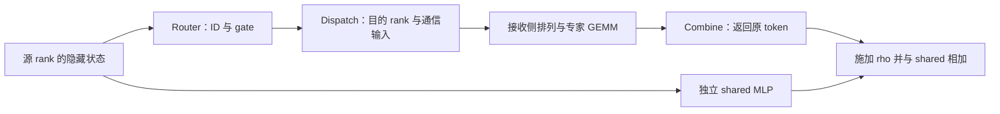

# MoE 专家并行执行：映射、通信与输出回传

专家并行（EP）把专家参数放在不同 rank 上。路由仍给出每个 token 的专家 ID 和 gate，但完整执行必须把隐藏状态送到拥有这些专家的 rank，将收到的行转成专家 GEMM 的输入，再把贡献送回原 token。本页沿固定 SGLang/vLLM 的 CUDA FP8 分支解释这条链，区分 normal/HT 与 low-latency 的布局和加权职责。

前置是 [MoE 结构与路由](../fundamentals/model/mixture-of-experts-and-routing.md)及[单设备 FP8 专家执行](moe-routing-and-quantized-expert-execution.md)。这里不重新定义 sigmoid/grouped top-k，也不把实现类支持的配置改写成 DeepSeek-V2 论文的路由公式。$M_r$ 表示源 rank $r$ 本轮进入 MoE 的隐藏状态行数；它不同于请求数、全局 token 总数，也不同于某个专家的 GEMM 行数。

本页承接框架中的映射、通信调用端和所选专家执行；匹配默认构建来源的 `deep_ep.Buffer` 设备实现已接续到 [DeepEP 通信执行](deepep-moe-communication-execution.md)，包含 normal/HT 去重与 LL 专家复制、scale/handle 和回源归约。具体设备条件与版本由该页保留；静态源码与教学记账不能代替实际拓扑、故障或性能结果。

## 1. 值语义与地址语义分别核对

令 $e_{t,j}$ 为 token $t$ 第 $j$ 个选中专家，$g_{t,j}$ 为对应 gate，$f_e$ 为完整专家函数。沿本页选定的 BF16 模型隐藏状态、独立 shared 分支，最终专家层输出应对应

$$y_t=f_{\mathrm{shared}}(x_t)+\rho\sum_{j=1}^{K}g_{t,j}f_{e_{t,j}}(x_t).$$

这写出的是已核实现的值语义，忽略量化与浮点舍入后便于核对各阶段；不表示执行可以任意交换量化、加权和求和次序。特别是非线性专家通常不满足 $f_e(gx)=g f_e(x)$。本页没有采用只支持 top-k=1 的输入加权配置。

gate 可以在接收侧的本地归约中施加，也可以交给通信 combine；要核对实际所有者，保证每项贡献恰好加权一次。$\rho$ 与 gate 也不是同一参数。本页所选 SGLang DeepGEMM 和 vLLM CUDA decoder 均在通信返回后施加 routed scaling，再与 shared 相加。decoder 的 residual 留在外层，不在此处再加一次。[S1，`forward_deepep`][VEP26，CUDA decoder 构造][VEP27，factory 的缩放参数][VEP12，runner 的 shared/routed 合成]

专家编号还要分清两个轴：

| 轴 | 解释的问题 | 本页边界 |
| --- | --- | --- |
| logical / physical | 是模型中的哪个专家函数，还是放置/通信中的哪个执行位置 | EPLB 的副本选择和搬迁未展开；round-robin 的通信重编号本身不创建副本 |
| global / local | 编号在整个 EP group 有意义，还是只索引当前 rank 的参数 expert 轴 | 不同 rank 的相同 local ID 可以对应不同全局专家 |

因此不能把它们当作所有后端共有的固定四级转换链。无冗余、连续均分且 $E$ 可被 $P$ 整除时，令 $L=E/P$，全局专家 $e$ 的位置为

$$\operatorname{owner}(e)=\lfloor e/L\rfloor,\qquad
\operatorname{local}(e)=e-L\operatorname{owner}(e).$$

教学例：$E=8,P=2$，全局专家 6 在 rank 1 的参数轴位置为 2；rank 0 的 local 2 则是全局专家 2。当前 rank 的映射返回 `-1` 表示这项不在本地处理，不表示整个 EP 层删除了该专家贡献；对应 owner 仍须负责它。[S2，global-to-local 加载映射][VEP7，`determine_expert_map`]

## 2. SGLang：固定分支、group 与专家映射

本节选择 `DeepseekV2MoE` 所承接的 DeepSeek 分组 noaux_tc 路由，CUDA SM90、BF16 hidden states、普通 E4M3 FP8 专家权重、128×128 权重块与动态激活量化，隐藏宽度 $D$ 与专家中间宽度 $I$ 均可被 128 整除。MoE A2A backend 为 `deepep`，runner 为 `deep_gemm`，JIT DeepGEMM 条件成立；共享专家融合关闭，独立 shared MLP 保留。关闭 EPLB、冗余专家、非 trivial placement、Waterfill、LoRA、TBO/SBO、辅助 stream 和 CUDA graph；不采用 FP4/MXFP8、V4 的 clamped SwiGLU。为固定可核读的第二次激活量化实现，选 `SGLANG_OPT_USE_JIT_EP_ACTIVATION=False`、`SGLANG_MASKED_GEMM_FAST_ACT=False`、`SGLANG_OPT_FIX_MEGA_MOE_MEMORY=False`。这是供解释的源码分支条件，不表示已经在这种配置上运行通过。[S1][S3][S6][S7][S8][S12]

记全局 routed 专家数为 $E$、每 token 的 routed top-k 数为 $K$、EP rank 数为 $P$，要求 $E\bmod P=0$。固定 `moe_dp_size=1`、无 CP，`server_args` 对 DeepEP 将 `ep_size` 调整为 `tp_size`；因此这条路径中 $P=\text{tp\_size}$、MoE TP size 为 1。`FusedMoE` 的局部专家宽度仍由 `I / moe_tp_size` 得出，但这里每个局部专家保存完整 $I$，不是只保存 $I/P$。[S2，197–217 行][S14，5549–5557 行][S15，2198–2200、2231–2232 行]

输入 $X_q\in\mathbb R^{M_q\times D}$ 是**进入 MoE 的 rank $q$ 本轮行集合**，$M_q$ 不是自动等同于全局 token 数。该版本 sparse layer 使用 A2A backend 时，`LayerScatterModes._compute_mlp_mode` 选择 `SCATTERED`；普通 attention TP 输入到 scattered MoE 的衔接可在 communicator 内沿 attention TP reduce-scatter 并切 residual 行完成。DeepEP 专家层不自行决定每个请求上游在哪个 attention rank，它处理的是已交到本 rank 的输入行；本节不继续展开 DP attention/CP 的完整 layer 状态机。[S16，378–385、970–981、1120–1138 行]

无共享融合、无重排/冗余时，rank $q$ 的 routed 专家数为 $L=E/P$，拥有全局专家区间 $[qL,(q+1)L)$。`FusedMoE._map_global_expert_id_to_local_expert_id` 将区间内全局 ID $e$ 变成 $\ell=e-qL$，其他 rank 的专家返回 -1 并跳过加载。创建 FP8 权重时传入的 expert 轴长是 `num_local_experts=L`，所以本 rank 的 `w13`/`w2` 为 `[L,2I,D]` 与 `[L,D,I]`；普通块尺度为 `[L,2I/128,D/128]` 与 `[L,D/128,I/128]`，对应专家、输出块和归约块。EP 缩小 expert 轴，MoE TP 才负责专家内部宽度分片。[S2，210–217、302–307、603–611、638–651 行][S8，`create_weights`]

路由 logits 仍来自对所有 $E$ 个 routed 专家的 gate，不能只在本 rank 的 $L$ 个专家间做 top-k。与单设备页相同，sigmoid affinity $s_{t,e}$ 加 correction bias 用于专家/组选择，选中权重从未加 bias 的 $s$ 取出，并按选中集合归一化为 $g_{t,j}$。本节选 DeepGEMM FP8，`should_fuse_routed_scaling_factor_in_topk=False`，交付 gate weights 的行和为 1，尚未乘 routed scaling $\rho$。[S1，595–685、1216–1241 行][S2，331–344 行][S9，1076–1145、1875–1942 行]

正常 top-k 形成后还有 expert-location postprocess 接口。`topk_ids_logical_to_physical` 在 `info=None` 时原样返回；有真实 placement metadata 时会改写成物理 ID。本节选 trivial、无冗余的恒等 placement，只解释这个接口位置，不展开 EPLB 的副本选择与迁移。[S9，1339–1344、1727–1764 行][S10，79–107 行]

进入 DeepEP 前 `topk_ids[M_q,K]` 转为 int64；`topk_weights` 保留对应关系。normal 的返回 `recv_topk_ids` 被 SGLang 消费者当作**本地专家 ID**：`ep_scatter` 用每个非负 ID 直接索引长度为 $L$ 的专家起点表。远端不可用 top-k 槽通过负值跳过。匹配固定 Buffer 的 [设备 dispatch](deepep-moe-communication-execution.md#3.%20Intranode%20normal%2FHT%EF%BC%9A%E5%89%8D%E7%BC%80%E3%80%81%E9%98%9F%E5%88%97%E4%B8%8E%E6%9C%AC%E5%9C%B0%20ID)已确认有效 ID 减去本 rank 的全局专家起点，非本地 ID 为 -1、对应 gate 为 0，并按目的 rank 去重隐藏状态；hierarchical 分组条件另由设备页保留。[S4，489–490、553–572、884–895 行][S7，756–833、853 行]

## 3. SGLang normal：二维接收行到专家连续行

模型 A2A 分支先形成 top-k，再调用 `self.experts`。`get_moe_impl_class` 返回 `DeepEPMoE`；对本节 FP8 + JIT DeepGEMM，`deprecate_flag=True`，沿继承的 `FusedMoE.forward_impl` 执行 dispatch → `Fp8MoEMethod.apply` → combine。此处的标志名不表示删除 DeepEP，而是让旧类里的专用计算分支转交公共 runner。[S1，1405–1408 行][S3，90–93、175–179、271–279 行][S2，1114–1163 行]

normal `dispatch_a` 在 `ENABLE_JIT_DEEPGEMM and use_fp8` 条件下，先在 SGLang 对原输入每行、每 128 个 hidden 通道动态量化：FP8 $\hat X_q[M_q,D]$ 与恢复尺度 $A_q[M_q,D/128]$ 组成 tuple 一起送给 Buffer。所选 SM90 下 `DEEPGEMM_SCALE_UE8M0=False`，尺度是普通 FP32；到 DeepGEMM 前可再转成 TMA 对齐布局，数值 scale 不因此变成另一个全层常数。只有该条件成立时 normal 包装才在这里预量化，不能由 dispatcher 的 output dtype 名称泛化所有 normal 分支。[S4，484–501 行][S18，458–540 行][S12，17–39 行][S6，203–204 行]

`dispatch_b → _dispatch_core` 先调用 `Buffer.get_dispatch_layout(topk_ids,E)`，获得 per-rank/per-RDMA-rank/per-expert 计数与 token-in-rank 标记，再把它们和输入、ID、gate 交给 `Buffer.dispatch`。JIT DeepGEMM 请求 `expert_alignment=128`；返回值包括 `recv_x`、接收端 ID/gate、每本地专家的接收行计数列表和返程 handle。包装等待 event 后才交付 runner。[S4，503–586 行]

记 `R=recv_x.shape[0]`，`A=sum(num_recv_tokens_per_expert)`。SGLang 接收的二维行布局为 `[R,D]`，随后 `pre_permute_deepep_normal_to_deep_gemm` 按 Buffer 返回的对齐计数分配 `[A,D]` 的 expert-contiguous 输入与 `[A]` 的 `m_indices`，并分配 `[R,K]` 的 `output_index`：[S6，708–797 行]

- `m_indices[a]` 指出连续计算行 $a$ 使用哪个本地专家权重；计数的前缀和确定各专家区间。这里 `A` 包含请求对齐所需的行容量，不能直接称作本轮真实路由配对数。
- 对接收行 $r$ 的每个有效本地 top-k 槽 $j$，`ep_scatter` 用 atomic add 在相应专家区间取得计算行 $a$，复制这一行的 FP8 数值及尺度，并保存 `output_index[r,j]=a`。同一接收行有多个本地专家时，在这一阶段才扩成多个专家计算行。
- 负 ID 槽不复制、不写有效 output index。专家内 atomic 顺序不是原 token 次序；最终靠 `output_index` 找回对应结果。[S7，723–918 行]

这与单设备 Triton 的“保存原 `[M,D]`，kernel 依配对位置间接回读”不同：这里 rank 间通信已经返回接收行，SGLang 又物理复制到按本地专家组织的连续输入。不能把 `R`、`A`、原 rank 输入行数 $M_q$ 与全局配对数混用；所选 Buffer 按目的 rank 去重已由 [设备源码](deepep-moe-communication-execution.md#2.%20Rank%20%E8%A1%8C%E6%95%B0%E4%B8%8E%E4%B8%93%E5%AE%B6%E9%85%8D%E5%AF%B9%E6%95%B0%E4%B8%8D%E5%90%8C)核实，但队列元素计费、跨节点组 fanout 与实际链路流量仍应分开判断。

`Fp8MoEMethod` 创建 `DeepGemmMoeQuantInfo`，传入本地 FP8 权重、块 scale 和 block shape；`MoeRunner` 按 dispatch format `deepep_normal` 查 pre/post adapter，core 选 `_run_contiguous_gemm`。第一 grouped GEMM 用 `m_indices` 选择局部专家，写 BF16 `[A,2I]`；SiLU×up 形成 BF16 `[A,I]`，重新按行和 128 个 $I$ 通道量化，第二 grouped GEMM 写 BF16 `[A,D]`。两个 GEMM 的调用都没有 gate 权重参数，未在 input 或 down 输出中乘 $g$。[S8，1764–1789、1941–1978 行][S5，137–165 行][S6，164–295 行]

所选 normal 的 `SGLANG_OPT_FIX_MEGA_MOE_MEMORY=False` 分支先写 BF16 SiLU 中间值，再调用 per-token-group quant。另一 flag 分支可融合 activation 与量化，但不属于本文固定链。匹配 `sgl-deep-gemm 0.1.3` 的 [SM90 专家设备链](deepgemm-moe-expert-execution.md)已接续定制入口/TVM-FFI/JIT、tile 首行专家选择、TMA/scale、分组 WGMMA 与 BF16 写回。scatter 给全部对齐行写非负专家 ID，只有有效配对写值/scale；对齐 padding 仍可参与两次 GEMM/激活，最终 gather 只消费有效 output_index。[S6，218–275 行][S13，112–139 行]

## 4. SGLang normal：本地加权，再按 handle 返回

`post_permute_deep_gemm_to_deepep_normal` 分配 BF16 `[R,D]`，用 `ep_gather` 为每个接收行遍历有效本地槽，从 `output_index` 找回专家结果，并在 FP32 accumulator 中计算

$$z_r=\sum_{j:\,\mathrm{recv\_id}_{r,j}\ge0} g_{r,j}\,\widetilde f_{\ell_{r,j}}(x_r).$$

最后转为 BF16 `[R,D]`。$\widetilde f$ 包含 FP8 与中间舍入误差；这里只是本 rank 持有专家的加权贡献，还没回到源 rank 汇合所有目的 rank。kernel 跳过负 ID，也因此不会读取对应未写的 output index。[S6，800–826 行][S7，922–1022 行]

normal combine 包装直接采用这个已经本地加权的张量，调用 `Buffer.combine(x,self.handle,...)`；这个调用没有传 top-k weights，所以 SGLang 层不能再给返回结果乘一次 $g$。Buffer 负责按 handle 回传/汇合；[设备返程](deepep-moe-communication-execution.md#4.%20Normal%20FP8%20%E5%B9%B3%E9%9D%A2%E3%80%81%E5%85%AD%E9%A1%B9%20handle%20%E4%B8%8E%E8%BF%94%E7%A8%8B)将 BF16 行提升为 float 做跨 rank sum，再转 BF16；hierarchical 另有组内归约后转为 BF16 的中间舍入。完整外部协议与真实拓扑/性能未运行验证。[S4，588–621 行]

该版本 CUDA normal 的 `combine_a` 只接受 JIT DeepGEMM（以及本节不采用的 AITER/NPU）条件，else 直接抛 `NotImplementedError`，注释说明 Triton normal combine 临时禁用。原单设备页可以完整读通 Triton，不代表相同 runner 能直接沿 DeepEP normal 跑通。[S4，595–598 行]

## 5. SGLang LL：expert-batched 输入与返回加权

`DeepEPMode.AUTO` 在 batch 含 extend 时 resolve 为 normal，否则为 low latency；这是 batch 级条件，不是仅按每个请求的 token 数自动选择。显式 mode 保留其值。[S11，147–175 行][S4，953–961 行]

low latency `dispatch_a` 将 BF16 原输入与 int64 top-k ID 交给 `Buffer.low_latency_dispatch`，传 `use_fp8=True`。SGLang 在这个入口没有先调用自己的 per-token-group quant；FP8 转换发生于外部 Buffer 路径；匹配默认来源已确认每 token/128 通道动态量化、正 FP32 restoring scale 与 per-expert 发送，详见 [LL 设备 dispatch](deepep-moe-communication-execution.md#6.%20LL%20dispatch%EF%BC%9A%E5%8F%91%E9%80%81%E9%87%8F%E5%8C%96%E4%B8%8E%E4%B8%93%E5%AE%B6%E5%AE%B9%E9%87%8F)。在 Blackwell DeepGEMM 条件下包装会请求 `round_scale/use_ue8m0`，本节 SM90 传这两个条件为 False。[S4，648–746 行][S12，37–39 行]

返回 payload 被 SGLang masked runner 按 `[L,C,D]` 消费：第一轴对应本地专家，匹配固定库返回每专家容量 $C=P M_{\max}$。`masked_m[L]` 保存实际有效行数，容量尾部不保证初始化为有效数据；column-major FP32 scale 的逻辑 shape 为 `[L,C,D/128]`，元素 strides 为 `((D/128)*C,1,C)`。[设备布局与有效 segment](deepep-moe-communication-execution.md#6.%20LL%20dispatch%EF%BC%9A%E5%8F%91%E9%80%81%E9%87%8F%E5%8C%96%E4%B8%8E%E4%B8%93%E5%AE%B6%E5%AE%B9%E9%87%8F)保留 source info/range 与库条件。`topk_ids/topk_weights` 仍是源 rank 原输入的 `[M_q,K]` 对应，未改成 normal 的接收行列表；它们在 dispatch 时没有作为 weights 传入 Buffer，留在 Python 对象中等待返程。[S4，648–703、729–746 行][S6，666–688、401–414 行]

包装计算的提示值严格是

$$\mathrm{expected\_m}=\left\lfloor\frac{M_q P K+E}{E}\right\rfloor.$$

它是按本 rank 行数估算的平均配对负载提示，用作 masked grouped-GEMM 参数；它不是 `masked_m` 的真实计数、buffer 上限或 token 丢弃阈值，代码也不在这里裁掉超过平均值的行。$M_qPK$ 恰好整除 $E$ 时，这个表达式仍比商多 1，不能无条件改写成通常的 ceil。[S4，656–659 行][S6，406–414、478–487 行]

LL 的 pre-adapter 不再 scatter；它把已经三维组织好的输入和 scale 直接交给 `_run_masked_gemm`。两次 GEMM 依 `masked_m/expected_m` 计算：FP8 输入和本地 `w13` → BF16 `[L,C,2I]` → SiLU×up 与每 128 通道量化 → FP8 `[L,C,I]`/FP32 scale `[L,C,I/128]` → BF16 down `[L,C,D]`。所选 fallback activation kernel 只迭代 `token_index < masked_m[expert_id]`，对有效行做 SiLU×up 与动态 group scale，容量尾部不应被读作有效专家输出。匹配 [masked 设备调度](deepgemm-moe-expert-execution.md#4.%20%E8%B0%83%E5%BA%A6%E5%A6%82%E4%BD%95%E9%80%89%E6%8B%A9%E4%B8%93%E5%AE%B6%E4%B8%8E%E8%A1%8C)按有效计数选择 tile 与 math warp-group 起点，没有逐行 masked store，尾 tile 仍可计算/写容量 padding；所选默认 `Mmax=128` 保持每专家容量按 M tile 对齐。[S6，362–496、829–919 行][S7，289–429 行]

LL core 和 post-adapter 都没有乘 $g$ 或 $\rho$。post-adapter 仅把未加权 down 输出与保存的原 ID/weight 包装成 `DeepEPLLCombineInput`。随后 `Buffer.low_latency_combine(x,topk_idx,topk_weights,handle)` 得到源 rank 的输出。因此这里 gate 的应用/跨专家归约归属 low latency combine 的外部接口，SGLang runner 不先本地乘一次；匹配固定库的 [LL combine](deepep-moe-communication-execution.md#7.%20LL%20combine%EF%BC%9A%E5%9B%9E%E5%88%B0%E5%8E%9F%20token%20%E5%90%8E%E6%96%BD%E5%8A%A0%20gate)按源端原 top-k 槽序读取 BF16 专家输出，乘 FP32 gate、用 float 累加，最后写 BF16。[S6，692–704 行][S4，748–819 行]

## 6. SGLang：shared、rho 与一次往返的生命周期

两条 DeepEP adapter 的 EP post-permute 都没有施加 $\rho$；`forward_deepep` 在 `self.experts` 完成 dispatch/core/combine 后才做最终模型层合成。本节 `should_fuse_routed_scaling_factor_in_topk=False`、CUDA 非 AITER：有独立共享输出时采用 `shared_output.add_(routed_output,alpha=rho)`；没有共享输出时直接 `routed_output *= rho`。数学值语义为

$$y_t=\rho\sum_{j=1}^{K}g_{t,j}\widetilde f_{e_{t,j}}(x_t)+y_t^{(s)}.$$

独立 shared MLP 在 DeepEP 构造时显式 `tp_rank=0,tp_size=1`，对本 rank 原输入行计算完整共享输出，再与回传的同一源行合成。共享部分不应再乘 $\rho$，也不应随全局 EP 数量重复加 $P$ 次。`FusedMoE` 的 `reduce_results` 在本模型构造采用默认 False，`forward_deepep` 返回后没有再执行单设备 `forward_normal` 末尾的全 TP all-reduce。[S1，693–723、1216–1227、1405–1433 行][S2，157–174、1136–1139 行]

这条路径的 FP8 通信指 dispatch 的 hidden-state payload。两次 down grouped GEMM 的输出均为 BF16，normal combine 和 LL combine 的调用不在 SGLang 包装内对返程专家输出再执行 FP8 量化。不能把“FP8 dispatch”写成 router、专家输出、整个往返通信与所有累加都只有 8 bit；也不能由位宽独自推出端到端速度。[S4][S6]

通信 Buffer 与每次路由 handle 的生命周期不同。`DeepEPBuffer` 以 class 成员缓存 Buffer，通过 normal config 的 size hints 与 LL size hint 建立通信存储；模式从 normal 切到 low latency 时先 `clean_low_latency_buffer`。[设备页](deepep-moe-communication-execution.md#8.%20%E4%BC%A0%E8%BE%93%E3%80%81event%E3%80%81hook%20%E4%B8%8E%20buffer%20%E7%94%9F%E5%91%BD%E5%91%A8%E6%9C%9F)已核 odd/even 共用布局与两套 signaling clean；clean 不表示全部容量尾部激活清零。[S4，161–296 行]

每个 dispatcher implementation 把 dispatch 返回的 opaque `handle` 放在实例成员里，供同一轮 combine 使用，不作为 `DeepEPNormalDispatchOutput/DeepEPLLDispatchOutput` 的字段传播。normal `_dispatch_core` 的注释明确说明尝试随 tokens 传 handle 曾发生同步问题，所以当前采用成员保存。这是固定版本现状，不应由文档自行设计一套新状态对象。[S4，95–149、364、547–559、613–620 行]

外层 `DeepEPDispatcher` 按 `INITIAL → AFTER_DISPATCH_A → AFTER_DISPATCH_B → AFTER_COMBINE_A → INITIAL` 验证操作顺序，A/B 中间状态暂存在实例字段，再消费删除；同一实例不能任意交错多轮 dispatch/combine。本节关闭 TBO，不展开其多实例组织。[S4，833–965 行]

创建入口为 normal 设置 `async_finish=True`，LL 设置 `return_recv_hook=True`。normal 在预量化完成后 `Buffer.capture()`，layout/dispatch/combine 接力 `previous_event`，dispatch_b/combine_b 调 `event.current_stream_wait()` 后交给后续消费，normal combine_b 再清 handle。LL 的 A 段发起外部 dispatch/combine，B 段执行 recv hook；若 return_recv_hook=False 则等待 event。LL `_combine_core` 在发起 combine 后就清 Python `packed_recv_count/handle`，但最终数据可消费仍由 B 段的 hook/event 衔接，不能把 `handle=None` 当成 GPU 通信已完成。[S2，101–116 行][S4，484–511、588–608、674–684、748–819 行]

[设备页](deepep-moe-communication-execution.md#8.%20%E4%BC%A0%E8%BE%93%E3%80%81event%E3%80%81hook%20%E4%B8%8E%20buffer%20%E7%94%9F%E5%91%BD%E5%91%A8%E6%9C%9F)确认 event 是 CUDA stream 依赖，LL hook 分开 SEND/RECV phase，并核 Buffer IPC/NVSHMEM 回收入口。SBO、多 stream down/communication overlap、CUDA graph capture/replay、完整 NVSHMEM/IBGDA 协议与真实拓扑/故障仍未沿运行链验证。

## 7. vLLM：固定配置与 EP group

选 `DeepseekV2MoE` / CUDA 普通 BF16 输入、已序列化 E4M3 专家权重、`weight_block_size=[128,128]` 与 dynamic activation；专家数量 $E$ 能被 EP rank 数 $P$ 整除，中间维 $I$ 是 128 的整数倍。全局配置取 `data_parallel_size=P>1`、TP=PCP=SP=1，开启 expert parallel，显式 `moe_backend="triton"`，并关闭 DeepGEMM E8M0 scale 模式（`VLLM_USE_DEEP_GEMM_E8M0=0`），使本页 HT/设备内 group scale 使用普通 FP32数值。先按 linear 专家放置、没有 EPLB/冗余/融合共享专家/LoRA/DBO/特殊 graph/latent transform 分支解释。共享专家仍为单独 MLP。设备必须满足被选 FP8 kernel 的源码支持检查，DeepEP 依赖也必须可用；这些是代码前提，本次没有验证真实环境满足它们。[VEP1–VEP4][VEP6–VEP10][VEP29]

本页对照三条平行路线，每次只选择其中一条：

| all2all backend | prepare/finalize | 输入专家的布局 | `moe_backend="triton"` 实际选择 | 专家本地输出的权重/归约职责 |
| --- | --- | --- | --- | --- |
| `deepep_high_throughput` | `DeepEPHTPrepareAndFinalize` | Standard：二维 `[M_recv,D]` | `TritonExperts` | GEMM2 乘路由权重，专家实现做本地 top-k sum；随后 HT combine 返回来源 rank |
| `deepep_low_latency` | `DeepEPLLPrepareAndFinalize` | BatchedExperts：三维 `[E_local,T_cap,D]` | oracle 将请求改为 `BATCHED_TRITON`，类为 `BatchedTritonExperts` | 专家输出保持分专家三维形式，`Delegate` 把权重施加与回收交给 LL combine |
| `allgather_reducescatter` | `MoEPrepareAndFinalizeNaiveDPEPModular` | Standard：二维汇集行 | `TritonExperts` | GEMM2 加权、本地 sum，然后 AG/RS manager 执行 reduce-scatter |

LL 不能接普通 `TritonExperts`：oracle 根据 all2all 配置先选择 activation format，显式 triton 在 BatchedExperts 下被改成 batched 变体；专家支持检查和 `FusedMoEKernel._post_init_setup` 都检查 P/F 与专家格式一致。HT 也不能把 LL 三维输出的 `BatchedTritonExperts` 当成普通二维专家。这张表是实际 factory/类接口可串连的组合，不是实测可用性或性能排名。[VEP4，`select_fp8_moe_backend` 288–292、329–356，`make_fp8_moe_kernel` 670–718；VEP5，576–577、1599–1608；VEP9–VEP10]

`parallel_state.initialize_model_parallel` 的全局 rank 张量维度顺序为 ExternalDP×DP×PP×PCP×TP。EP group 将 DP 与 PP 维转置后，把同一 ExternalDP、同一 PP stage 中的 DP×PCP×TP 展成一组；PP stage 不混入同一个 EP group。[VEP2，1787–1802、1893–1919]

`FusedMoEParallelConfig.make` 先展平 MoE 的并行维：

$$
P_{\rm flat}=DP\cdot PCP\cdot TP,\qquad
r_{\rm flat}=r_{DP}(PCP\cdot TP)+r_{PCP}TP+r_{TP}.
$$

当 `P_flat>1` 且 `enable_expert_parallel=True` 时，MoE expert 的 `ep_size=P_flat`、`ep_rank=r_flat`，**专家本体的 MoE TP 改为 1，tp_rank 改为 0**：一张卡持有其本地完整专家，而不是持有每个专家的张量分片。这里不表示 attention 或共享 MLP 的 TP 被改成 1。关闭 EP 时，MoE TP 使用这个展平范围，EP size 则为 1。[VEP3，1112–1121、1204–1251]

启用 EP 仍不自动启用 all2all kernel。实际开关为：

$$
\texttt{use\_all2all\_kernels}=\texttt{use\_ep}\land
(DP>1\ \lor\ PCP>1\ \lor\ SP>1).
$$

因此只有 TP>1、DP=PCP=SP=1 的 EP 配置不会进入本页的 HT/LL P/F；该情形沿 NoDPEP P/F 处理本地输入、用 expert map 只计算本地专家，随后根据 runner 条件进行最终 TP all-reduce。下文选 DP=P>1、其他维为 1，使 EP rank 与 DP rank 一致，避免把 TP 复制输入、SP 分块、PCP 或不同 rank 组的逻辑并入同一教学链。[VEP3，1047–1066；VEP6，139–156；VEP18，40–97；VEP12，436–466]

## 8. vLLM：global/local 与 round-robin 通信重编号

路由给出全局专家 ID，checkpoint 也按全局专家辨识；专家权重的第 0 维只保存本 rank 的 local slot。`determine_expert_map` 创建 int32、形状 `[E]` 的映射，本地专家映射到 `0...E_local-1`，非本地专家为 `-1`；EP size=1 时不创建映射。[VEP7，22–113]

对一般 $E$、$P$，令 $b=\lfloor E/P\rfloor$、$q=E\bmod P$。实际代码把余数分给前 $q$ 个 rank：

$$
E_r=b+\mathbf1[r<q],\qquad s_r=rb+\min(r,q).
$$

linear 的全局范围为 `[s_r,s_r+E_r)`，local slot 为 `e-s_r`。round-robin 则使全局专家 $e$ 归 rank $e\bmod P$，local slot 为 $\lfloor e/P\rfloor$。例如 $E=8,P=2$：linear 的 rank 0 存 `[0,1,2,3]`，rank 1 存 `[4,5,6,7]`；round-robin 分别存 `[0,2,4,6]` 与 `[1,3,5,7]`。源码 docstring 说余数给“last rank”，与 67–69 行的实现不符；本页按实现说明，不复述该注释。[VEP7，66–87]

一般 map 能表达不均分，不代表所有 DeepEP 组合都支持不均分：HT factory 用 `rank*num_local_experts` 当 offset，LL handle 用 `E//world_size` 当本地专家数；本页统一限制 $E\bmod P=0$，没有从 map 的能力推断 DeepEP 的不均分支持。[VEP6，162–189]

在 all2all 路线中，请求 round-robin 还要求多 expert group、无 redundant experts、无 EPLB；需要 routing tables 的后端只有 LL/NIXL，所以 HT 会回退 linear。LL 的 round-robin 在 global ID 与 owner-contiguous 的 physical ID 间额外置换：`owner=e%P`、`local=floor(e/P)`，`physical=owner*b+min(owner,q)+local`。`global_to_physical`、其逆表和本地 global IDs 被注册为 RoutedExperts buffer；LL 在 dispatch 与 combine 两端都把 top-k global IDs 映射到 physical IDs，而 batched 专家计算仍按本地权重槽读取。本页所选 linear 路线无需这些表。[VEP7，116–149、417–475、477–516；VEP8，231–260；VEP14，155–158、290–304、396–408]

## 9. vLLM HT：prepare、二维专家执行与 BF16 combine

调用所有权依次为：`MoERunner._apply_quant_method` 做 router top-k → `RoutedExperts.forward_modular` → `Fp8MoEMethod.apply` → `FusedMoEKernelModularImpl.apply` 的 prepare、专家执行、finalize。FP8 方法在权重后处理时选择专家 class，再由 `make_fp8_moe_kernel` 创建配套 P/F；通信 manager 属于 EP group 的 device communicator。[VEP12，547–596；VEP8，1151–1186；VEP13，683–718、833–856；VEP4，670–718；VEP6，59–72]

prepare 返回 `(x, x_scale, expert_tokens_meta, dispatched_topk_ids, dispatched_topk_weights)`。HT 返回重新分发的 IDs/weights，modular wrapper 用它们替换原始路由张量；LL 的最后两项均为 `None`，wrapper 保留原始 owner 上的 IDs/weights供 combine 使用，batched 专家不靠这些张量再重新路由。[VEP5，140–158、1214–1229；VEP14，328–342；VEP15，258–264]

HT/LL 都在 dispatch 时保存外部 DeepEP 返回的 handle，combine 必须使用同一次 dispatch 的 handle。两者保留两槽 `handles` 是为了按 DBO ubatch 区分；本页关闭 DBO，但不能把 handle 理解成可自由复用的全局路由表。async 的 hook/receiver 只描述接收完成的接口，不能仅凭 Python `prepare_async` 名称证明整条链已经与专家计算有效重叠。[VEP14，100–104、252–325、386–408；VEP15，65–68、175–192、357–387]

设本 rank 起始输入 `a1:[M_r,D]`、路由 ID/weight 均为 `[M_r,k]`，本地权重 `w13:[E_local,2I,D]`、`w2:[E_local,D,I]`。普通 FP8 block scale 分别为 `[E_local,ceil(2I/128),ceil(D/128)]` 与 `[E_local,ceil(D/128),ceil(I/128)]`；Triton/BatchedTriton 不做其他 backend 的载入布局变换。[VEP13，534–598、620–643；VEP4，546–561]

HT P/F 按如下顺序连接通信与专家：

1. 对所选 block FP8 配置，在来源 rank 先调用 `moe_kernel_quantize_input`，得到 E4M3 `a1q:[M_r,D]` 与 FP32 row/group scale `[M_r,D/128]`。HT 把 `(a1q,scale)` 作为 `x`；非 block quant 路线先传原 dtype，接收后才量化。本页无 LoRA，也不启用 defer-input-quant。[VEP15，269–322、240–256；VEP16，132–155；VEP17，567–650]
2. `get_dispatch_layout(topk_idx,num_experts)` 返回 per-rank/per-RDMA-rank 计数、专家计数与 `is_token_in_rank`，随后 `buffer.dispatch` 同时传激活/scale、topk ID 与 weight，`expert_alignment=1`。这是 P/F 的跨 rank dispatch；专家内部为 GEMM tile 做的 block alignment 是另一个阶段。[VEP15，130–171]
3. receiver 得到二维 `expert_x:[M_recv,D]`、接收行的 top-k 和每本地专家计数。外部 DeepEP 的有效 top-k IDs 是 local ID，vLLM 加 `rank_expert_offset=r*E_local` 恢复 global ID；对 -1，rank 0 改成 `E-1`，其他 rank 改成 0，刻意选择本 rank 之外的合法 global ID，让下一步 expert map 再映射回 -1。此步骤依赖本页 linear、均分的条件，不能套到 HT round-robin。[VEP15，194–264]
4. `TritonExperts` 对接收 top-k 生成 token–expert 配对和 padding；`expert_map` 把对应 block 的 global expert ID 改成 local slot，非本地为 -1，GEMM 对这些 block 写零。这里“本地加总”仅得到该 rank 所持专家对接收 token 的贡献，不是来源 token 的完整 routed output。[VEP9，271–304；VEP19，19–45、90–103；VEP20，407–434]
5. 普通 Triton 专家的 GEMM2 在 FP32 accumulator 上乘 `topk_weights`，再 cast 输出；`ops.moe_sum` 汇掉该接收行的 top-k 维。`finalize_weight_and_reduce_impl()` 返回 `NoOP`，表示专家已经完成这一层权重/局部归约。HT finalize 不再次乘权重，调用 `buffer.combine(x=fused_expert_output,handle=handle,topk_weights=None)`；wrapper 明确要求 combine 输入 BF16。外部 combine 依据 handle 返回来源 rank 的行，P/F 把结果复制到 `[M_r,D]` 输出，并报告 `output_is_reduced=True`。[VEP9，148–149、464–486、535–539；VEP20，562–576；VEP15，347–409；VEP21，44–77]

HT 的 $M_{recv}$ 是 dispatch 后的接收行数，不能直接写成 $M_rk$，也不能把一个接收行等同一个专家配对。匹配固定库已确认按目的 rank 去重，接收行再展开专家配对；普通 scale 原样复制为行连续 `[M_recv,D/128]`。[通信设备页](deepep-moe-communication-execution.md#3.%20Intranode%20normal%2FHT%EF%BC%9A%E5%89%8D%E7%BC%80%E3%80%81%E9%98%9F%E5%88%97%E4%B8%8E%E6%9C%AC%E5%9C%B0%20ID)给出 prefix/队列、六项 handle 与 hierarchical 组去重差异；本页不将逻辑行数计费当作精确网络字节。

## 10. vLLM LL：三维专家执行与通信尺度

LL 不把 top-k weights 传入 `low_latency_dispatch`。它传原始 `a1:[M_r,D]`、dispatch ID、每 rank 最大 token 数、全局专家数，以及 `use_fp8` / scale 编码标志。所选块 FP8 的 `use_fp8_dispatch=True`：量化在外部 DeepEP dispatch 内完成，vLLM 没有先调用来源端 `moe_kernel_quantize_input`。dispatch 返回分本地专家的激活/scale、每专家有效行数与 handle。[VEP6，174–207；VEP14，229–325]

进入 batched 专家的形状契约为 `x:[E_local,T_cap,D]`，每专家的有效行数记录在 `expert_tokens_meta.expert_num_tokens:[E_local]`，未使用区间由计数控制；P/F 不返回 dispatched top-k。vLLM batched 专家 workspace/output 按 `max_tokens_per_rank*num_dispatchers` 的容量分配，但这不是“每个专家真实处理这么多 token”，也不是实际网络包都按容量发送。匹配固定库返回每专家 $P M_{\max}$ 行容量，values 连续、首层 scale 为 token 轴连续的转置 view；[LL 设备布局](deepep-moe-communication-execution.md#6.%20LL%20dispatch%EF%BC%9A%E5%8F%91%E9%80%81%E9%87%8F%E5%8C%96%E4%B8%8E%E4%B8%93%E5%AE%B6%E5%AE%B9%E9%87%8F)给出确切 strides 与有效 segment。[VEP14，328–342；VEP10，817–837、875–884]

`BatchedTritonExperts` 的 MM1 按三维 expert 轴读取权重，用 `expert_num_tokens` 避开无效行；SiLU×up 后生成三维中间 `[E_local,T_cap,I]`，再按专家有效行量化、调用 MM2，输出仍为 `[E_local,T_cap,D]`。batched kernel 以 `tl.program_id(axis=0)` 选择本地 expert，没有再通过 global expert_map 路由，也没有在 GEMM2 中乘 top-k 权重。[VEP10，250–375、897–976]

其 `finalize_weight_and_reduce_impl` 返回 `Delegate`。LL finalize 明确只接受该契约，将原 owner 上的 `[M_r,k]` IDs/weights（round-robin 时 IDs 先变为 physical IDs）和同次 handle 传给 `low_latency_combine(...,out=output)`；代码注释把权重施加与归约归给该 combine kernel。正常 `apply_router_weight_on_input=False` 时传原始 weights，返回 `[M_r,D]`，P/F 报告 `output_is_reduced=True`。不能再套 HT 的“先 GEMM2 加权 + moe_sum + combine 不带 weights”顺序。[VEP10，799–801；VEP14，372–410]

LL wrapper 把 hidden size 向其列表中最近的不小于原值的尺寸对齐：2048、2560、3072、4096、5120、6144、7168、8192，超过最大值抛错；FP8 dispatch 另外要求 `D%128==0`。HT 的对齐规则则是 hidden bytes 按 512 字节取整。runner 在必要时 pad hidden rows 的最后维，最后裁回原维；这些是输入/权重形状的真实条件，不是 FP8 理论任意维度都可执行。[VEP14，57–83、246–257；VEP15，34–48；VEP6，75–114；VEP12，678–683、708–729]

LL 的生产 factory 只有在 `quant_dtype==current_platform.fp8_dtype()` 且 `block_shape==[128,128]` 时设 `use_fp8_dispatch=True`。这里权重的 128×128 block 与激活的每行 128 元素 group 是两种粒度：动态 activation scale 按 token 行×K group，对专家权重则按输出 block×输入 block。[VEP6，192–197；VEP16，148–153；VEP17，567–650；VEP10，83–131]

`DeepEPLLPrepareAndFinalize._do_quant` 对返回 tuple 的复用条件只检查 `block_k==128`：满足时直接复用 DeepEP 的 `(x,x_scales)`，没有恢复再量化。若显式构造 P/F 使 `use_fp8_dispatch=True` 但 block_k 不匹配，则以 FP32 乘 128-element scales 恢复，转回原 `a1_dtype`，再按专家量化配置执行 `moe_kernel_quantize_input`。因此外部传输格式与专家输入格式不一致时可能存在恢复/再量化；但不能把这个恢复分支说成无条件保护所有 dtype mismatch，因为 block_k=128 的分支没有再检查 qdtype。实际 factory 的严格选择条件把本页生产链限定在匹配的 FP8/128 配置。[VEP14，34–49、160–224]

普通 LL+batched Triton 的 scale 接口需能按 `[expert,row,K_group]` 读取，Triton wrapper 取 `stride(0/1/2)`，不会因为逻辑 shape 为三维就要求连续。`normalize_batched_scales_shape` 仅把标量复制为 `[E_local,1,1]`，把二维非标量 view 为 `[E_local,-1,last_dim]`；它不是任意转置或 swizzle 的转换器。MM2 新量化的激活 scale 在普通 block 分支分配 FP32 `[E_local,T_cap,ceil(I/128)]`。匹配 DeepEP 的首层 scale 先分配 `[E_local,D/128,T_cap]` 再转置，逻辑 `[E_local,T_cap,D/128]` 的 strides 为 `((D/128)*T_cap,1,T_cap)`，不同于 MM2 新分配的 row/group scale。[设备页](deepep-moe-communication-execution.md#6.%20LL%20dispatch%EF%BC%9A%E5%8F%91%E9%80%81%E9%87%8F%E5%8C%96%E4%B8%8E%E4%B8%93%E5%AE%B6%E5%AE%B9%E9%87%8F)核对其实际写入。[VEP10，378–445、651–714、920–959；VEP16，365–378]

UE8M0 是另外一层条件。LL 构造时 `use_ue8m0_dispatch=False`；`post_init_setup(fused_experts)` 只有在专家声明 `supports_packed_ue8m0_act_scales()` 且使用 FP8 dispatch 时才置 True，随后向 DeepEP 传 `round_scale=True,use_ue8m0=True`。普通 batched Triton 继承默认 False，所以本页不把 LL scales 说成 packed UE8M0。[VEP14，117–137、298–305；VEP5，755–760]

## 11. vLLM AG/RS 对照与最终缩放

**AG/RS P/F 是真实可选的标准布局通信路线。** `ParallelConfig` 会把已移除的 `all2all_backend="naive"` 转成 `allgather_reducescatter`，所以不能把 naive 当成另一条正常 DeepEP 类 backend。该实际选项的 P/F 类仍叫 `MoEPrepareAndFinalizeNaiveDPEPModular`，由 `AgRsAll2AllManager` 通信。[VEP1，448–454；VEP6，318–323；VEP22，137–155]

该 P/F 在 dispatch 前量化，并把 hidden values、top-k weights、top-k IDs 与动态 scale 一起 all-gatherv；只有 scale 为 None 或 ndim=0 时跳过 scale gathering，静态 scale 在原 rank 复用。本页选普通 FP8，scale 保持行对齐。[VEP23，16–68、112–185]

在本页 DP=P、TP=PCP=SP=1 条件下，manager 用 DP group，依据 `dp_metadata` 的各 rank token 数沿 dim0 汇集 `[sum_r M_r,D]`；每 rank 的 `TritonExperts+expert_map` 只贡献本地专家，P/F 的 finalize 先应用所选 `TopKWeightAndReduce` 契约，再由 manager reduce-scatterv 回各 token owner。AG/RS P/F 报告 `output_is_reduced=False`，runner 保留按 TP/EP 条件进行晚期 TP all-reduce 的代码契约；本页 global TP=1，所以该后续 TP collective为单 rank，不能笼统把 False 解读成“DP reduce-scatter 没做 sum”。当 SP 时 manager 改用 EP group，DP=1 时改 PCP group，这些条件不是当前主线。[VEP23，187–209；VEP24，43–149；VEP12，436–466]

实际 DeepSeek CUDA decoder 在非 AITER 条件下传 `apply_routed_scale_to_output=True`。factory 将 router 和 RoutedExperts 的 rho 设为 1，把真实 rho 交给 runner。所选 BF16 路线在 P/F 返回后对 routed output 乘 rho，再加独立 shared；shared 不乘 rho。通用 factory 的默认参数不能替代这个实际调用端。[VEP26，1250–1256 行][VEP27，293–300、385–387、411–416 行][VEP12，697–727 行]

HT/LL 的 P/F 都报告 `output_is_reduced=True`，runner 避免再对 routed output 做最终 TP all-reduce。shared 若采用全局 TP 分片则有自己的归约条件；当前 TP=1，不需要跨 TP 汇合。AG/RS 的标志为 False，保留晚期 TP/EP 判定，但当前 TP=1 使后续 TP collective 为单 rank。这些标志是框架执行契约，不能只按名称推断已经做过哪些通信。[VEP12，410–466、697–727 行][VEP5，1610–1615 行]

普通 `naive_block_assignment` 是小批次的设备 tile 分派，选择条件要求 `expert_map is None`；本页 EP 有 map，采用 align/map 路径。这个名字不等于一个可正常选择的 `all2all_backend="naive"`，也不表示 DeepEP 的真实网络布局。[VEP1，448–454 行][VEP20，1480–1526 行]

## 12. 专家配对数、目的 rank 数与实际成本

下面是整理者根据已核接口建立的记账模型，不是外部 DeepEP 的逐字节通信协议。对每个源 token 定义目的集合

$$\mathcal R_t=\{\operatorname{owner}(e_{t,j}):1\leq j\leq K\},\qquad
1\leq |\mathcal R_t|\leq\min(K,P).$$

前提是有 $K>0$ 个有效选择且没有模型 dropping。四个专家 `[0,1,6,7]` 在上述连续放置中只覆盖两个 rank。按这个教学记账，一个目的 rank 的唯一 token 计数与专家计算配对数分别是

$$n_r=\sum_t\mathbf 1\{r\in\mathcal R_t\},\qquad
m_e=\sum_{t,j}\mathbf 1\{e_{t,j}=e\},\qquad
c_r=\sum_{e:\operatorname{owner}(e)=r}m_e.$$

求和跨本轮所有源 rank 的 token，token 身份应包含源 rank 与源行号。$n_r$ 和 $c_r$ 不等价：同一 token 在 rank 内选了两个专家，在此记账中贡献一个唯一 token、两个专家配对。normal/HT 的布局接口同时返回 rank 计数与 expert 计数；SGLang normal 用 `ep_scatter` 物理复制为专家连续行，vLLM HT+Triton 则保留二维接收输入、建立配对索引，由第一 GEMM 间接回读原行。LL 直接向 expert-batched 消费者交付输入与有效行计数。通用教学计数不能单独证明实际复制策略；所选 normal/HT 的 rank 去重和 LL 的每专家复制另由 [固定设备源码](deepep-moe-communication-execution.md#2.%20Rank%20%E8%A1%8C%E6%95%B0%E4%B8%8E%E4%B8%93%E5%AE%B6%E9%85%8D%E5%AF%B9%E6%95%B0%E4%B8%8D%E5%90%8C)核实，其他分支仍需沿其实现判断。[S4，normal layout/dispatch][S6，normal pre-permute][S7，`ep_scatter`][VEP15，HT layout/receiver][VEP9，`TritonExperts.apply`][VEP20，第一 GEMM 的 `offs_token//top_k`][VEP14，LL receiver]

若教学模型假定同一 token 每个远端目的 rank 只发送一次，通信输入宽度为 $D$、每元素 $b_x$ 字节、每 $G$ 个元素一项 $b_s$ 字节尺度，则其逻辑有效载荷为

$$B_{\mathrm{dispatch}}^{\mathrm{logical}}=
\sum_t |\mathcal R_t\setminus\{\operatorname{source}(t)\}|
\left(D b_x+\left\lceil D/G\right\rceil b_s\right).$$

这排除了本地目的 rank，尚未计路由 ID/gate、handle 元数据、对齐、协议、节点转发或网络中的重复传输。FP8 值加 FP32 的 128 元素组尺度在整除条件下为每元素 $1+4/128$ 字节；不能简单说整个往返通信都减半。两个框架所选 normal/HT 返回 BF16，LL 返回也消费专家输出；输入压缩不会自动压缩返回贡献。UE8M0 打包尺度则须按实际格式重新计费。 已核 LL 按专家 selection 发送副本，其报文与 slot 预留分别见 [通信设备页](deepep-moe-communication-execution.md#6.%20LL%20dispatch%EF%BC%9A%E5%8F%91%E9%80%81%E9%87%8F%E5%8C%96%E4%B8%8E%E4%B8%93%E5%AE%B6%E5%AE%B9%E9%87%8F)，不能套用 normal 的目的 rank 唯一行假设。[S4][S6][VEP15，prepare/finalize][VEP14，`_do_quant/post_init_setup`]

| 容量或行数 | 具体含义 | 如何影响结果与成本 |
| --- | --- | --- |
| runtime buffer capacity | 通信缓冲区按上限分配的空间 | 约束配置与显存，未读 overflow 实现时不能宣称超限会静默 dropping |
| 实际 expert token count | 专家本轮有效输入行 | 决定有效工作，不等于平均负载提示或容量 |
| GEMM/布局 padding | 为 alignment/tile/支持的维度补空间 | 结果由有效计数、mask 或逆映射限制；补齐空间可能仍产生额外执行工作，不自动改变模型路由 |
| 模型 token dropping | 取消选中 token–专家的一项贡献 | 改变该次 MoE 值语义；V2 训练条件见[负载与 dropping](../fundamentals/model/mixture-of-experts-and-routing.md#3.%20%E5%B9%B3%E8%A1%A1%E6%8D%9F%E5%A4%B1%E4%B8%8E%20token%20dropping%20%E8%A7%A3%E5%86%B3%E4%BB%80%E4%B9%88%E9%97%AE%E9%A2%98) |

例如 SGLang normal 按对齐计数建立全部 $A$ 行的 `m_indices`，contiguous GEMM 接收容量张量；最终 gather 只按有效 top-k 的 `output_index` 回读结果。这里不能说所有 padding 都在 GEMM 中被 mask 掉。[S6，contiguous core/normal pre-post][S7，`ep_scatter/ep_gather`]

判断 EP 成本要沿 layout/count → dispatch → 接收侧排列/尺度转换 → 专家 GEMM → 本地归约 → combine 与同步分别定位。没有 overlap 的分项可相加；有 overlap 时应观察实际依赖与关键路径，不能把 `async_finish` 或 hook 的存在当作通信已经完全隐藏。

同一批 token 总数下，$m_e$、$n_r$、$c_r$ 的分布仍会不同，热点专家或 rank 可形成尾部等待。实际评测应记录这些分布、padding 后形状、输入/返回 dtype 与尺度、EP/TP/DP group、网络拓扑、prefill/decode 和 backend，再用[服务性能口径](serving-performance-evaluation.md)判断 TTFT、TPOT、尾延迟与 goodput。权重量化减少常驻载荷，与通信量化减少 dispatch 载荷是两个决策；其关系还可对照[张量并行的通信边界](tensor-parallel-quantization.md#5.%20%E7%9C%81%E6%8E%89%E6%9D%83%E9%87%8D%E6%B5%81%E9%87%8F%EF%BC%8C%E4%B8%8D%E4%BB%A3%E8%A1%A8%E9%80%9A%E4%BF%A1%E5%90%8C%E6%AD%A5%E7%BC%A9%E5%B0%8F)。

## 13. 本页确认范围

本页核对固定框架的 group、专家位置映射、所选通信 P/F、接收侧排列、本地两次 FP8 GEMM 调用、gate/rho/shared 归属与 handle/event/hook 衔接。量化公式的已有解释见单设备页；这里明确各接口消费的是哪种形状和尺度，未把通信 API 的 flags 当成外部 kernel 已被逐步核验。

匹配默认构建来源的 DeepEP 版本与所选设备通信已在 [接续页](deepep-moe-communication-execution.md)核对，包含 rank/组去重、per-expert 复制、载荷/scale/handle 与归约舍入。匹配 SGLang 默认包的 [DeepGEMM contiguous/masked SM90 专家设备链](deepgemm-moe-expert-execution.md)也已接续；无 overlap 调用相符，SBO 的 enable_overlap/max_block_n/signal 不在该包 API 中。完整 NVSHMEM/IBGDA 传输协议、异常恢复/真实拓扑/性能及其他专家设备分支仍未核。EPLB/冗余副本迁移、融合 shared、Waterfill、LoRA、SBO/TBO/DBO、多 stream/graph、SP/PCP/CP 扩展、DeepEPv2 和其他通信/专家 backend 没有沿完整链审查。

没有安装依赖、编译、运行模型/GPU 或测量质量/通信/性能。本页已经完成的是所选分支的静态源码解释；硬件支持与模型配置能否实际运行须由对应运行任务判断。

### v0.6.17 的 MegaMoE 集成与参数缓存

固定 FlashInfer v0.6.17 发布说明报告 `flashinfer.moe_ep` 的 MegaMoE 路径支持完整 CUDA graph capture/replay、单次 launch 的 quantize-and-stage、预量化 weight packs，以及跨层共用的 symmetric-buffer workspace。它还报告持久 knob cache：生产会话按查找取得已调参数，避免在引擎内 autotuning。这种 cache 存的是调优参数，不是单设备页的 `intermediate_cache1/2/3` 激活缓冲，也不等于 DeepGEMM 的 JIT/编译产物缓存；三者不能用同一生命周期或容量预算。（来源 v0.6.17 Highlights，MoE expert parallelism；#4079，仅核发布声明。）

发布说明另称可选 fault-tolerance rank mask 在 NCCL-EP/NIXL-EP 上跳过 dispatch/combine 超时的 peer，以维持作业运行（#4183）。它没有解释缺失专家贡献、gate/归一化、恢复和数值完整性，因此不能将“继续运行”改写为结果与无故障路径相同。knob 的 key/失效规则、缓冲复用同步与 graph 执行顺序也未在材料中展开。CuTe-DSL 最低运行版本回到 4.5.2、对应 vLLM 0.25.1 的说明（#4101）不替代本页两个框架、DeepEP 和 DeepGEMM 的固定版本；以上新路径未沿源码或运行闭合。

## 来源身份与定位

- FlashInfer Release v0.6.17（`https://github.com/flashinfer-ai/flashinfer/releases/tag/v0.6.17`），snapshot-2026-08-20，获取于2026-08-20T02:38:02+08:00；MegaMoE graph/量化/weight/workspace/knob 与可选 rank mask、依赖声明，未核对应 PR、完整协议或运行。

- SGLang 固定源码（`https://github.com/sgl-project/sglang/tree/2f730e299f3b574e3bee2c6ef9669fa2a5b26dbc`），完整 commit `2f730e299f3b574e3bee2c6ef9669fa2a5b26dbc`；下表 S 编号的路径相对该快照。
- vLLM 固定源码（`https://github.com/vllm-project/vllm/tree/568afb3a13806beb53bb2e6bd518269357b237c0`），完整 commit `568afb3a13806beb53bb2e6bd518269357b237c0`；下表 VEP 编号的路径相对该快照。两个框架版本分别核读，不声明在同一运行环境完成集成。

| 引用 | 固定快照内文件 | 核读位置与本页作用 |
| --- | --- | --- |
| S1 | `python/sglang/srt/models/deepseek_v2.py` | `DeepseekV2MoE.__init__` 530–810；`forward` 853–916；`forward_deepep` 1201–1433：gate、构造参数、共享 MLP、rho 与 A2A 调用入口 |
| S2 | `python/sglang/srt/layers/moe/fused_moe_triton/layer.py` | `create_moe_dispatcher` 84–126；`FusedMoE.__init__` 157–344；`_map_global_expert_id_to_local_expert_id/weight_loader` 603–713；`forward_impl/run_moe_core` 1114–1163 |
| S3 | `python/sglang/srt/layers/moe/ep_moe/layer.py` | `DeepEPMoE.__init__/forward_impl` 49–185；`get_moe_impl_class` 271–285：EP 类继承与当前 runner 接口 |
| S4 | `python/sglang/srt/layers/moe/token_dispatcher/deepep.py` | 输入输出 tuple 95–153；`DeepEPBuffer` 161–296；dtype 397–459；normal 476–633；LL 636–830；外层 stage、模式选择 833–995 |
| S5 | `python/sglang/srt/layers/moe/moe_runner/runner.py` | `MoeRunner.__init__/run` 27–167：backend 与 dispatch format 的 pre/core/post 分派 |
| S6 | `python/sglang/srt/layers/moe/moe_runner/deep_gemm.py` | 数据结构 90–122；`run` 136–162；contiguous 164–295；masked 362–496；EP pre/post 665–826；`_varlen_deep_gemm_silu_mul_quant` 829–919 |
| S7 | `python/sglang/srt/layers/moe/ep_moe/kernels.py` | masked activation/quant 289–429；scatter 723–918；gather 922–1022；TMA scale alignment 1025–1099 |
| S8 | `python/sglang/srt/layers/quantization/fp8.py` | DeepGEMM backend 判定 873–888；`create_weights` 890–1080：局部 FP8 参数与块 scale；`create_moe_runner` 1764–1789；`apply` 的 DeepGEMM quant-info 分支 1941–1978 |
| S9 | `python/sglang/srt/layers/moe/topk.py` | `biased_grouped_topk_impl` 1076–1145；postprocess 1339–1344、1727–1764；`_remap_topk_for_deepep` 1622–1690；`select_experts` 1875–1942 |
| S10 | `python/sglang/srt/eplb/expert_location_dispatch.py` | `ExpertLocationDispatchInfo.init_new` 27–64；transform 与 `topk_ids_logical_to_physical` 67–107：恒等/真实 placement 接口，不展开 EPLB |
| S11 | `python/sglang/srt/layers/moe/utils.py` | `DeepEPMode` 147–175；`DeepEPOutputDtype/get_deepep_output_dtype` 178–245；`get_moe_weight_sizes` 543–572：所选非 AITER 非 packed 权重宽度 |
| S12 | `python/sglang/srt/layers/deep_gemm_wrapper/configurer.py` | 17–39：JIT 开启条件、Blackwell 与 UE8M0/TMA scale 条件 |
| S13 | `python/sglang/srt/layers/deep_gemm_wrapper/entrypoint.py` | masked FP8 wrapper 27–77；contiguous FP8 wrapper 112–139：实际外部调用边界 |
| S14 | `python/sglang/srt/server_args.py` | 5549–5557：DeepEP 设置 ep_size=tp_size 与 normal graph 禁用 |
| S15 | `python/sglang/srt/distributed/parallel_state.py` | 2198–2200、2231–2254：MoE DP/EP/TP 的尺寸与 EP=TP 分组关系 |
| S16 | `python/sglang/srt/layers/communicator.py` | `_compute_mlp_mode` 378–397；模式转移选择 970–981；`_scatter_hidden_states_and_residual` 1120–1138：A2A MoE 输入行边界 |
| S18 | `python/sglang/srt/layers/quantization/fp8_kernel.py` | `create_per_token_group_quant_fp8_output_scale/sglang_per_token_group_quant_fp8` 458–597：normal 预量化的输出 shape、dtype 与 per-group scale |
| VEP1 | `vllm/config/parallel.py` | EP/placement/all2all字段153–196；naive迁移448–454；sequence/batched DP条件645–680 |
| VEP2 | `vllm/distributed/parallel_state.py` | rank layout1787–1802；EP/EPLB group1893–1942 |
| VEP3 | `vllm/model_executor/layers/fused_moe/config.py` | `FusedMoEParallelConfig` 1031–1268，FP8quant构造592–623 |
| VEP4 | `vllm/model_executor/layers/fused_moe/oracle/fp8.py` | backend/class136–200；format/selection271–419；Triton布局保留546–561；`make_fp8_moe_kernel`670–718 |
| VEP5 | `vllm/model_executor/layers/fused_moe/modular_kernel.py` | activation/return契约52–158；expert构造478–503；supported-format541–579；defaultUE8M0 755–760；prepare替换1214–1229；主链1421–1473；post_init1599–1615 |
| VEP6 | `vllm/model_executor/layers/fused_moe/all2all_utils.py` | EPmanager59–72；hidden对齐75–114；P/F factory117–207、318–323 |
| VEP7 | `vllm/model_executor/layers/fused_moe/expert_map_manager.py` | `determine_expert_map`22–113；placement116–149；routing初始化417–516 |
| VEP8 | `vllm/model_executor/layers/fused_moe/routed_experts.py` | expert_map/mask/routing tables225–278；forward_modular1151–1186 |
| VEP9 | `vllm/model_executor/layers/fused_moe/experts/triton_moe.py` | Standard/支持/NoOP74–149；map/alignment271–304；GEMM2/归约450–539 |
| VEP10 | `vllm/model_executor/layers/fused_moe/experts/fused_batched_moe.py` | batched GEMM83–152、250–445；NaiveBatchedExperts492–648；batchedquant651–714；BatchedTritonExperts717–976 |
| VEP12 | `vllm/model_executor/layers/fused_moe/runner/moe_runner.py` | scale/归约390–466；route到专家547–596；pad/共享汇合678–729；legacy外置通信732–840仅区分所有权 |
| VEP13 | `vllm/model_executor/layers/quantization/fp8.py` | FP8MoE选型/张量534–598、620–643；P/F初始化683–718；apply833–856 |
| VEP14 | `vllm/model_executor/layers/fused_moe/prepare_finalize/deepep_ll.py` | 全部关键类接口与FP8恢复/dispatch/combine34–448；所选匹配 external 通信另见设备页 |
| VEP15 | `vllm/model_executor/layers/fused_moe/prepare_finalize/deepep_ht.py` | hidden对齐34–48；handle65–68；layout/dispatch106–192；receiver194–264；prepare269–345；combine347–410 |
| VEP16 | `vllm/model_executor/layers/fused_moe/utils.py` | FP8quant132–155、dtype分派266–303、batched scales356–378 |
| VEP17 | `vllm/model_executor/layers/quantization/utils/fp8_utils.py` | `per_token_group_quant_fp8`567–695 |
| VEP18 | `vllm/model_executor/layers/fused_moe/prepare_finalize/no_dp_ep.py` | NoDPEP Modular接口/本地量化与finalize40–97 |
| VEP19 | `vllm/model_executor/layers/fused_moe/moe_align_block_size.py` | global→local map与padding接口19–103 |
| VEP20 | `vllm/model_executor/layers/fused_moe/fused_moe.py` | 非本地block写零与第一GEMM间接读取407–470；GEMM加权562–576；`_prepare_expert_assignment`1480–1526 |
| VEP21 | `vllm/model_executor/layers/fused_moe/topk_weight_and_reduce.py` | Delegate/NoOP11–77；Contiguous80–121；NaiveBatched124–176 |
| VEP22 | `vllm/distributed/device_communicators/cuda_communicator.py` | AG/RS、HT、LL manager选择137–155 |
| VEP23 | `vllm/model_executor/layers/fused_moe/prepare_finalize/naive_dp_ep.py` | quant/scale16–68；Modular prepare/finalize71–209；Monolithic212–301仅区分外置router logits |
| VEP24 | `vllm/distributed/device_communicators/all2all.py` | AG/RS43–149；DeepEPbuffer支持/生命周期155–207；HT209–267；LL270–361 |
| VEP26 | `vllm/model_executor/models/deepseek_v2.py` | MoE构造277–387、forward397–426；decoder传rho模式1250–1256 |
| VEP27 | `vllm/model_executor/layers/fused_moe/layer.py` | factory并行/placement219–278；rho293–300、385–387、411–416 |
| VEP29 | `vllm/utils/deep_gemm.py` | 仅核读 `is_deep_gemm_e8m0_used` 与所依赖支持判定93–124 |
