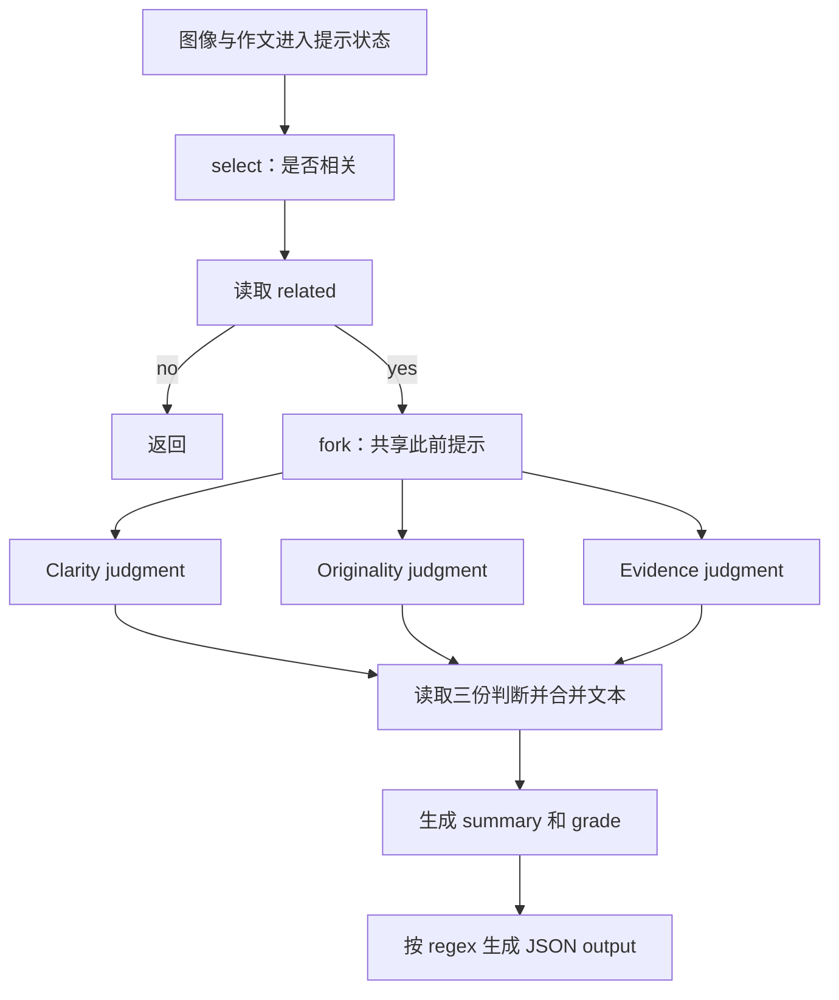

# 结构化语言模型程序：依赖、前缀共享与约束解码

一次应用任务可能先让模型判断输入，再分支生成几份分析，读取结果后继续汇总，最后输出 JSON。这里的计算对象是**由多次模型调用组成的程序**：每次调用有自己的提示和输出，后续调用依赖前面的结果。优化单次 decode 不能消除重复前缀、串行调用和格式约束带来的全部成本。

本页依据 SGLang 原论文 arXiv:2312.07104v2，解释提示状态如何暴露依赖，以及开放权重运行时 SGLang Runtime（SRT）和黑箱 API 分别怎样利用这些信息。现代固定源码的请求、槽位和批次主线见[SGLang 推理执行](sglang-inference-execution.md)；两者的版本和解释范围分别保留。KV 的计算时序见[自回归推理](../fundamentals/model/transformer-autoregressive-inference.md)，物理分页与共享见[服务内存管理](serving-memory-and-batching.md)。本次没有运行程序或服务。

## 1. 提示状态、分支生成与结果依赖

SGLang v2 把领域专用语言（DSL）嵌入 Python。状态 s 保存提示及命名的生成结果，`s += text` 追加文本，`gen(name)` 生成并保存变量，`select(name, choices=...)` 从给定选项中选择，`s[name]` 读取结果。提示不是一次性拼好后提交的静态字符串，而是可以继续扩展的执行状态。（§2，图2、表1。）

图2的图像作文评审包含以下依赖，箭头为依据原程序整理的关系：

`select`、`gen`、`extend` 向提示流提交工作，本身不等待生成完成；后台线程中的 stream executor 推进该流。**读取生成变量才等待结果就绪**。因此读取 `related` 后，Python 可以据结果执行 if；三份判断没有相互依赖，可以先提交，再在合并处等待。每一份生成内部仍按自回归顺序推进，前端并行不证明三个分支在硬件上同时执行。（§2。）

图2实际 fork 三份状态，在每份中追加对应维度指令并生成 `judgment`；原状态读取三份结果，用 Python 的 `"\n".join(...)` 合并为局部变量 judgment，再通过 `s += assistant(judgment + ...)` 将其放入原提示，继续生成 summary、grade 和受约束 output。这里的字符串合并不能误记成 SGLang 的 `join` 原语，尽管语言另有该原语。Fork 暴露了共同提示和分支结构；运行时可以据此复用 KV，而不用重新理解应用含义。

## 2. RadixAttention 保留跨调用的前缀 KV

对因果模型，同一完整前缀在相同模型、位置及其他条件下产生相同的前缀 KV；相同局部文本出现在不同前文中，不满足这个条件。Few-shot 的共同示例、分支推理的共同祖先、聊天的历史轮次，因而都可形成复用路径。复用的是**已经过前向计算的 KV**，不能由“输出文本已采样”推断最后一个 token 已有 KV。（§3、附录A.1–A.2；时序见[自回归推理](../fundamentals/model/transformer-autoregressive-inference.md)。）

Radix tree 的边可以保存一段 token 序列，沿根到节点的路径表示完整前文。树结构在 CPU 上，关联的 KV 存在非连续 GPU 页中；**v2 论文的页大小为一个 token**。运行时匹配新提示的最长已缓存前缀，只计算未命中的后续部分，再维护树。现代源码支持的 page size、身份字段和末 token 限制另见[缓存匹配](sglang-inference-execution.md#2.%20Radix%20tree%20%E4%BF%9D%E5%AD%98%E7%9A%84%E6%98%AF%E5%89%8D%E7%BC%80%E5%85%B3%E7%B3%BB%E4%B8%8E%20KV%20%E7%B4%A2%E5%BC%95)，不能倒填为原论文实现细节。（§3，图3。）

历史缓存和正在运行的请求使用同一 KV 内存池，没有为历史前缀预留固定容量。每个节点的引用数保护运行请求使用的路径；回收按最近最少使用（LRU）策略从可淘汰叶子开始，共同祖先仍可保留，直到它也成为可淘汰叶子。请求完成后，提示和已计算的生成历史可以继续供以后复用，**释放运行引用不等于立即释放全部 KV**。当新批次需要空间时，缓存又可让出容量。（§3。）

Fork 的前端提示也有作用：前端先向运行时发送共同前缀，使它先入树，再发送分支的完整提示。否则并发提交的几个分支可能在共同前缀尚未形成缓存时分别重算。这是程序结构给调度器的信息，不能单由“有前缀树”推出同样效果。（§3，§6.3 frontend hint 消融。）

多模态输入须保留身份：论文用图像 hash 参与前缀键，不能因为两份提示有相同图像占位 token 就共享不同图像的 KV。论文未完整给出 hash 碰撞和所有预处理身份规则。（§6.2。）数据并行时，各 worker 保持本地树，路由器维护 meta-trie，优先把请求发给可复用前缀的 worker；worker 的回收队列和路由器在低活动时的更新维持弱一致性。附录报告四 worker 的 MMLU 吞吐近线性扩展，但没有据此保证任意负载的最优路由。（附录A.4。）

## 3. DFS 最优命中率依赖离线请求与缓存容量

论文把命中率定义为“复用的 prompt token 数 / 全部 prompt token 数”。当等待请求很多，频繁切换到不同前缀会淘汰后面还要使用的共同路径；优先处理较长已匹配前缀有助于延续同一子树。（§3。）

定理3.1讨论的是**已知的一批离线请求**。初始缓存为空，把请求放入同一 radix tree，缓存容量至少容纳最长请求路径。按深度优先遍历（DFS）完成一棵子树，再转向另一棵：共同祖先在该子树计算期间不断被使用，不会先被淘汰，已完成的叶子则可以让出空间。于是每条边的 KV 只需首次计算一次。（定理3.1、附录A.3。）

将原证明的计数改写为：S 是请求 prompt 长度之和，E 是树的边集合，|e| 是边含有的 token 数；C 表示**新计算的 KV token 数**，不是 FLOPs 或运行时间。则

$$C_{\min}=\sum_{e\in E}|e|,\qquad h_{\max}=1-\frac{C_{\min}}S.$$

教学例：请求为 `[a,b,c]`、`[a,b,d]`、`[a,e]`，总 prompt 长度 S=8，树只含 a、b、c、d、e 五个不同前缀位置。依次处理前三者可先复用 ab，再复用 a，C=5，命中率为 3/8。缓存只需容纳最长路径三个 token，不要求整棵树同时驻留；这是对离线 KV 计数的示例，没有加入生成或运行开销。

原文的最长共享前缀优先与 DFS 等价，须放在不断更新缓存的上述离线过程里理解，不能理解成对最初空缓存做一次排序就保证所有连续批次最优。在线到达会打断 DFS；未知输出长度可能挤出缓存并触发重算，原文脚注明确排除了这种实际计算与证明的差异。贪心排序还可能使短命中请求饥饿，公平性结合留作后续工作。（§3、附录A.3。）

附录算法1提供“匹配、排序、保护、分配/回收、运行、解除引用和入树”的流程，但其 `current_size` 初始化为零后没有更新，`req.size()` 等容量口径也未完整定义。因此它可用于解释动作顺序，不能作为完整、可运行的接纳算法；本页不以现代 `PrefillAdder` 补造历史实现。

## 4. Compressed FSM 把确定文本合成一次前向

正则约束先转换成有限状态机（FSM）。常规约束解码跟踪当前状态，将不合法的候选 token 概率置零，生成后推进状态。JSON 的固定键名、引号和分隔符即使已由格式决定，也可能占多个模型 token；若逐 token 调用 runner，仍要经过多轮 decode。（§4，图4、附录B.1。）

SGLang v2 把连续的 singular-transition 边压缩：每条这类边的起点只有一个后继，而且只允许一个字符或字符串。连续确定边拼到前一条边上，前一条边本身可以有分支。生成结果选定某条压缩边后，已确定的后缀可直接追加，再以多 token 前向继续，称为 Jump Forward。它减少的是多轮调用，**不是免去新文本的 KV 计算**；后续生成仍须有一致的模型历史。（§4、附录B.1–B.2。）

字符串边界与 tokenizer 边界并不一致。例如 JSON 固定文本不能随意拆成几段，当作模型预训练时使用的 token。原文处理方式是用原 tokenizer **重新分词此前全部文本和压缩边文本**，再进入后续生成。v2 未完整交代边界 token 改变时的 KV 失效及恢复算法；本页保留该实现缺口，不推定只重分词后缀或直接沿用全部旧 KV。（附录B.2。）

格式合法也不保证选项概率正确。同一候选字符串可能由多条 token 序列生成，准确的字符串概率应汇总这些路径。原文举例：把等级标签改成 `Excellent|Above Average|Fair|Below Average` 时，压缩边可能把生成的 A 扩成 Above Average，不能认为模型已按完整语义比较这些等级。把 choices 或 regex 写入 prompt 有帮助，但原文明确说它没有解决概率失真；因此 JSON 可解析、内容正确、分布保持是三个不同判断。（附录B.3。）

## 5. API speculative execution 复用额外生成文本

黑箱 API 模型不能使用 SRT 的内部 KV 或 runner 修改。论文 §5 改为利用跨调用模板：程序先生成 `name`，遇换行停止，再追加 `job:` 并生成职业；直接执行需要两次 API 调用，第二次重新计入前文的输入费用。

启用 API speculative execution 后，第一次调用暂时忽略停止条件，多生成一些文本。解释器保留额外输出，与后续原语所需的固定文本匹配，成功时复用后面的生成结果，从而可能省掉一次调用。它依赖模型继续输出符合模板的文本，收益随 prompt 和匹配成功率变化；这是应用程序跨调用的文本复用，与 draft 模型逐 token 验证的推测解码有不同对象。

§6.2 的 Wikipedia 示例用 GPT-3.5，依次生成三个字段，作者报告约三倍的输入 token 费用下降。额外生成的输出 token 仍可能计费，输入费用下降不等于总费用按同样倍数下降。该数值不是今日 API 价格或本轮测量；v2 没有完整给出匹配失败的全部回退、成功率和参数协议，不能由一次例子保证任意模板都省时省钱。

## 6. 编译图保留流顺序与变量依赖

解释器默认运行 Python；编译模式用抽象参数执行程序，将 `ConstantText`、`Argument`、`Gen`、`Select`、`Variable`、`Fork`、`GetForkItem`、`Join` 表示为 IR 节点。同一提示流按顺序连接，读取另一流变量时增加依赖；graph executor 按依赖发起工作，各 stream executor 推进自己的流。（附录D.1，图14。）

这一编译方式不支持依赖生成结果的数据控制流，因此第1节的 `if s["related"] ...` 不能仅因 DSL 有编译器就视为全图编译。图14(b)的第二个扩展分支还把变量标成 `tip_1`，而图14(a)的程序读取 `tip_2`；解释依赖时应按程序核对，不能照图标签建立错误的跨分支连接。

编译器可以尝试把常量文本前移，扩大多个实例的共同前缀，但**改变自然语言 prompt 次序并非严格保语义变换**。附录D.2用20个模板、5个few-shot示例生成提示，15个测试 prompt 经作者人工判断有12个语义一致，平均共同前缀增加60 token。这说明重排存在收益机会和失败案例，没有证明程序输出、任务质量或所有模板语义等价。

## 7. 性能证据的程序口径与适用范围

主实验默认解释器，Llama-7B FP16、单张 A10G 24GB。对照为 Guidance 0.1.8/llama.cpp、LMQL 0.7.3/Hugging Face，以及用默认 API 编写程序的 vLLM 0.2.5；作者选择旧 vLLM 是因为后续版本已部分整合 RadixAttention。部分任务因基线缺功能或过慢未比较。Mixtral-8×7B另用8张A10G、Llama-2-70B另用4张A100 80GB做TP；不能把这些结果拼成当前跨硬件排行榜。（§6.1、附录C。）

实验的计数对象须分别保留：

| 结果 | 测量对象和条件 | 能支持的判断 |
| --- | --- | --- |
| 主吞吐，图5、7及附录图12 | 足够大的一批完整程序，programs/s | 多调用应用的整体完成速率 |
| 主延迟，图6 | 一次完整程序、无程序批处理的平均执行延迟 | 程序主线及分支等待的时间，不等于单调用TTFT |
| 命中/消融，图8、13 | prompt token复用；图8(a)为tokens/s，图8(c)为Llama-7B/单A10G | 缓存、前端并行及hint在特定任务中的作用 |
| 约束输出，§6.3 | JSON decoding；重复每请求预处理与复用FSM分开 | 作者报告compressed FSM吞吐1.6×；逐请求重做预处理时，吞吐降至复用版本的约1/2.4 |

作者汇总称相对所测基线吞吐最高达到基线的6.4倍、程序延迟最多降至基线的约1/3.7；归一化图、不同任务和不同系统的极值不能合成一次配置的联合收益，也不能替换[延迟SLO下的服务容量](serving-performance-evaluation.md)。论文没有提供同一在线SLO/goodput曲线或量化质量实验。（§6.2，图5–6。）

负载决定复用机会。MMLU使用5-shot、生成一个答案 token；HellaSwag使用20-shot和选择原语。Agent实验重放既有轨迹，而非评价闭环应用质量。四轮聊天每轮输入256–512 token，短输出4–8、长输出256–512：**长输出场景几乎没有加速**，因为 decode 占主导。§6.2报告的命中率为50%–99%，图13给出实际与最优命中率，“平均达到最优的96%”是相对最优命中率，不能写成绝对96%命中。（§6.1、附录C。）

多模态表2使用不同单位：LLaVA-1.5-7B/单A10G的图像吞吐从0.18到1.15 images/s；LLaVA-NeXT-34B/单A100 80GB的视频从0.02到0.10 frames/s，对照为作者所用Hugging Face实现。图像与视频不能合成同一吞吐，模板、帧复用和模型配置也不可省略。§6.2另报告单worker/model线上一月的LLaVA-NeXT-34B、Vicuna-33B命中率52.4%、74.1%，其中Vicuna-33B的平均首token延迟改善1.7×；这是作者部署观察，本轮未重放。

无命中时，作者对ShareGPT的100请求报告总运行74.3秒、树维护0.2秒，开销低于0.3%。这是该任务的维护时间占比，不能据此认为任意树规模或短请求都有同样开销。（§6.3。）本次完整阅读主文与附录A–D并回查关键原件图表；未逐点重建全部曲线，未核历史实现、所引博客、外部API协议或运行程序，现代源码所选链的范围继续独立记录。

## 来源身份

- SGLang: Efficient Execution of Structured Language Model Programs，`arXiv:2312.07104v2`，`https://arxiv.org/abs/2312.07104v2`；主文§1–8、附录A–D，原件图1–14、表1–2和算法1；本页推导与教学例单独说明，未核匹配历史代码或运行。
